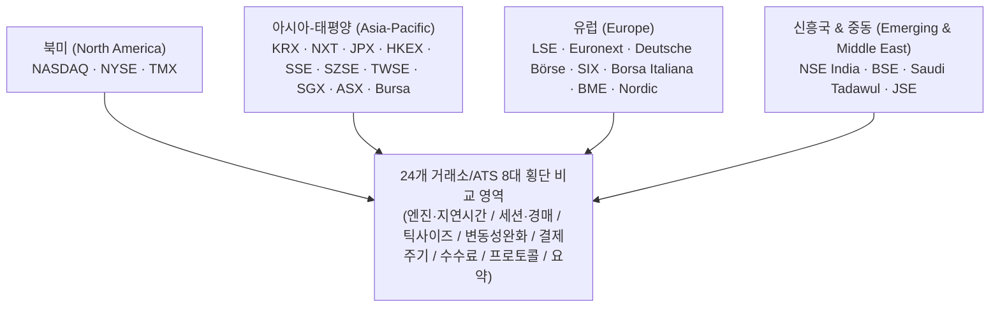
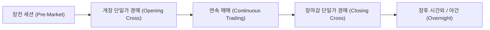
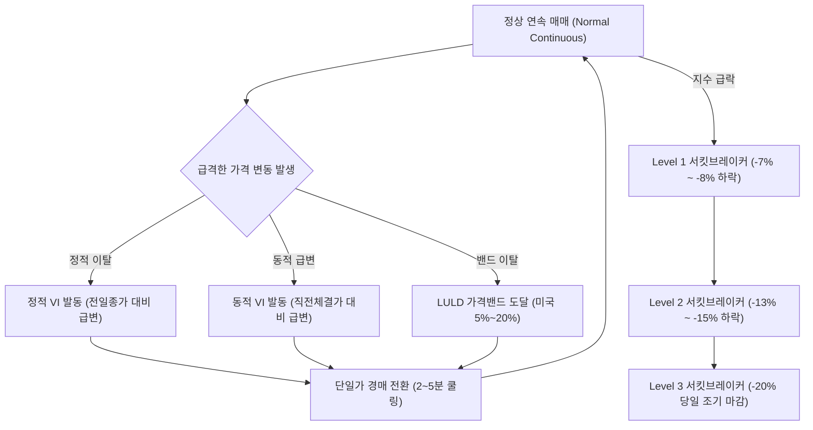
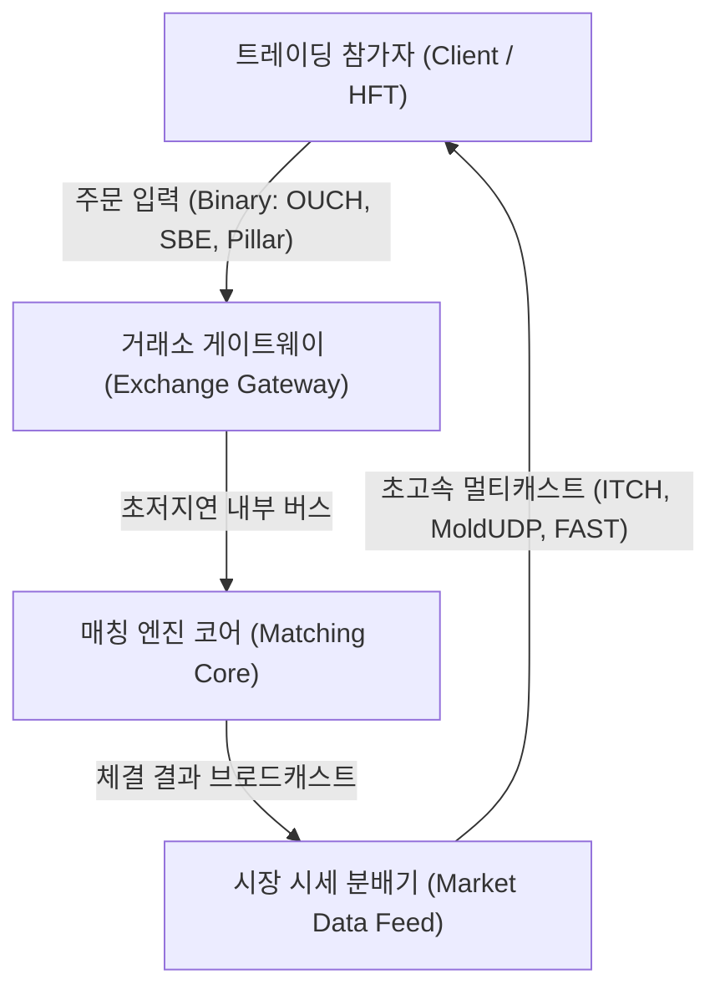

# 24개 글로벌 거래소 및 대체거래소(ATS) 종합 비교 매트릭스 (Global Comparison Matrix)

> **최종 업데이트:** 2026-10-22  
> **조사 등급:** Tier 1 Comprehensive Benchmark  
> **대상 범위:** 북미, 아시아-태평양, 유럽, 중동·신흥국 24개 거래소/대체거래소 및 주요 파생/옵션 시장  

---

## 1. 개요 및 벤치마크 목적 (Executive Summary)

현대 글로벌 자본시장은 초고속 통신망(Fiber/Microwave), 현장 전산센터 공동입주(Co-location), 하드웨어 가속(FPGA), 고도화된 매칭 엔진 아키텍처를 기반으로 극한의 나노초(ns) 단위 경쟁을 벌이고 있습니다.
본 리포트는 전 세계 24개 핵심 거래소 및 대체거래소(ATS)의 **매칭 엔진 성능, 일중 매매 메커니즘, 틱 사이즈 체계, 변동성 완화장치(VI/LULD), 결제 주기(T+1 vs T+2), 수수료 모델(Maker-Taker), 접속 프로토콜**을 횡단 비교하여 기관 투자자, 퀀트 트레이더, 거래소 시스템 엔지니어에게 구조적 통찰을 제공합니다.

---

## 2. 매칭 엔진 아키텍처 및 코어 레이턴시 비교 (Matching Engine & Latency)

| 거래소 (Exchange) | 엔진 명칭 (Platform) | 개발사 / 벤더 | 코어 왕복 지연시간 (RTT) | 아키텍처 특성 및 하드웨어 가속 |
|---|---|---|---|---|
| **NASDAQ** | INET / Eqlipse (4세대) | 자체 개발 (Nasdaq Tech) | **< 15 µs** (OUCH 기준) | FPGA 시세 분배, 마이크로서비스 및 AWS Outposts 하이브리드 클라우드 |
| **NYSE** | Pillar Engine | 자체 개발 (ICE) | **< 20 µs** | 결정론적(Deterministic) 단일 스레드 매칭 큐, 메모리 내 정렬 |
| **TMX (TSX)** | TSX Quantum | 자체 개발 | **~ 35 µs** | Linux x86 기반 멀티 스레드 분산 큐 |
| **KRX (한국거래소)** | Exture 3.0 | 코스콤 (자체 개발) | **< 50 µs** | 인메모리 프로세싱, Linux x86 클러스터, 저지연 커널 바이패스 |
| **Nextrade (NXT)** | NextStation Platform | 코스콤 (ATS 최적화) | **< 30 µs** | 인메모리 초저지연 매칭, K-SOR 연계, 중간가/스톱지정가 전용 큐 |
| **JPX (도쿄)** | Arrowhead 4.0 | 후지쯔 (Fujitsu) | **< 100 µs** | 초고신뢰 무정지 3중화 클러스터, 마이크로초 단위 시세 푸시 |
| **HKEX (홍콩)** | OTP-C (Orion Trading) | 자체 개발 | **< 80 µs** | 모듈러 파티셔닝, OCG 게이트웨이 바이너리 프로토콜 |
| **SSE (상하이)** | New Generation | 자체 개발 | **~ 150 µs** | 대용량 주문 폭주 방어형 세션별 큐잉 및 분산 처리 |
| **SZSE (선전)** | 5th Gen Trading System | 자체 개발 | **~ 120 µs** | 분산 노드 병렬 매칭, 초당 수십만 트랜잭션 수용 |
| **TWSE (대만)** | Continuous Trading Sys | 자체 개발 | **< 100 µs** | 2020년 연속매매 전환 이후 주기적 가속화 |
| **SGX (싱가포르)** | SGX Titan Engine | Nasdaq INET 기반 | **< 30 µs** | 글로벌 파생/주식 통합 고속 매칭 아키텍처 |
| **ASX (호주)** | ASX Trade & NTP | Nasdaq INET 기반 | **< 40 µs** | ITCH 피드 기반 실시간 오더북 브로드캐스팅 |
| **Bursa Malaysia** | BTS2 Engine | MillenniumIT | **~ 80 µs** | LSEG 테크놀로지 기반 분산 매칭 아키텍처 |
| **LSE (런던)** | Millennium Exchange | LSEG (MillenniumIT) | **< 25 µs** | C++ 저지연 엔진, 공유 메모리 큐, 멀티캐스트 전송 |
| **Euronext** | Optiq Platform | 자체 개발 | **< 15 µs** | 심플 바이너리 인코딩(SBE), FPGA 게이트웨이 가속 |
| **Deutsche Börse** | T7 Architecture | 자체 개발 | **< 20 µs** | 파생-주식 하이브리드 매칭 파이프라인, Eurex 공통 엔진 |
| **SIX Swiss** | SwissAtMid & OREX | Nasdaq INET 기반 | **< 30 µs** | 다크풀/리트북 동시 크로스 매칭 고속화 |
| **Borsa Italiana** | Optiq Engine | Euronext 통합 | **< 15 µs** | 유로넥스트 범유럽 단일 플랫폼 마이그레이션 완료 |
| **BME (스페인)** | SIBE System | SIX 그룹 통합 진행 | **~ 60 µs** | 스페인 전국 4개 거래소 연결 통합 전자북 |
| **Nasdaq Nordic** | INET Nordic | Nasdaq Tech | **< 20 µs** | 북유럽 4개국 공통 호가판 통합 매칭 |
| **NSE India** | NEAT+ Platform | 자체 개발 | **~ 80 µs** | 인도 전역 20만 개 이상 단말기 접속 분산 네트워크 |
| **BSE (봄베이)** | BOLT Plus | Deutsche Börse T7 라이선스 | **< 20 µs** | 초고속 T7 아키텍처 기반 인도 최고속 매칭 구현 |
| **JSE (요하네스버그)** | MillenniumIT | LSEG 라이선스 | **~ 70 µs** | 아프리카 최대 유동성 허브 전용 인프라 |
| **Saudi Tadawul** | Nasdaq X-Stream | Nasdaq Tech | **< 40 µs** | MENA 지역 최대 주식/파생 통합 매칭 플랫폼 |

---

## 3. 일중 매매 세션 및 경매 메커니즘 (Trading Sessions & Auctions)

### 세션별 특성 비교표

| 거래소 | 정규장 거래시간 (현지시간) | 정규장 거래시간 (KST 기준) | 점심 휴장 (Lunch Break) | 개장 경매 (Opening Auction) | 장마감 경매 (Closing Auction) | 24시간/연장 거래 (Extended) |
|---|---|---|---|---|---|---|
| **NASDAQ** | 09:30 - 16:00 | 22:30 - 05:00 (서머타임) | **없음** | 09:30 (Opening Cross) | 16:00 (Closing Cross) | **지원 (23시간 세션 운용)** |
| **NYSE** | 09:30 - 16:00 | 22:30 - 05:00 (서머타임) | **없음** | 09:30 (DMM 주도 경매) | 16:00 (Closing Cross) | **지원 (22-23시간 세션 운용)** |
| **TMX** | 09:30 - 16:00 | 22:30 - 05:00 | **없음** | 09:30 | 16:00 | 미지원 (일반 시간외만 운용) |
| **KRX** | 09:00 - 15:30 | 09:00 - 15:30 | **없음** | 08:30-09:00 (30분 수집) | 15:20-15:30 (10분 수집) | 시간외 단일가 (~18:00), 대체거래소(NXT) 연계 |
| **Nextrade (NXT)**| **09:00:30 - 15:20** | **09:00:30 - 15:20** | **정비구간 (08:50~09:00:30, 15:20~15:30)** | 미지원 (KRX 시가집중) | 종가매매 (15:30~16:00 KRX 종가체결) | **08:00~20:00 (12시간 매매)** |
| **JPX** | 09:00 - 15:30 | 09:00 - 15:30 | **있음 (11:30 - 12:30)** | 09:00 (Itayose) | 15:30 (2024년 연장 가동) | 야간 파생 세션만 지원 |
| **HKEX** | 09:30 - 16:00 | 10:30 - 17:00 | **있음 (12:00 - 13:00)** | 09:00 - 09:20 (POS) | 16:00 - 16:10 (CAS) | T+1 야간 선물 세션 |
| **SSE / SZSE** | 09:30 - 15:00 | 10:30 - 16:00 | **있음 (11:30 - 13:00)** | 09:15 - 09:25 | 14:57 - 15:00 | 미지원 |
| **TWSE** | 09:00 - 13:30 | 10:00 - 14:30 | **없음** | 08:30 - 09:00 | 13:25 - 13:30 | 시간외 고정가 매매 |
| **SGX** | 09:00 - 17:00 | 10:00 - 18:00 | **없음 (12:00-13:00 휴식 폐지)**| 08:30 - 09:00 | 17:00 - 17:06 | 글로벌 선물 24시간 연계 |
| **ASX** | 10:00 - 16:00 | 08:00 - 14:00 (동절기) | **없음** | 10:00 (랜덤 15초 종료) | 16:00 (랜덤 15초 종료) | 미지원 |
| **LSE** | 08:00 - 16:30 | 16:00 - 00:30 (서머타임) | **없음** | 07:50 - 08:00 | 16:30 - 16:35 | 국제 주식 세션 |
| **Euronext** | 09:00 - 17:30 | 16:00 - 00:30 | **없음** | 07:15 - 09:00 | 17:30 - 17:35 | 장후 TAL (Trading At Last) |
| **Deutsche Börse**| 09:00 - 17:30 | 16:00 - 00:30 | **없음 (중간경매 13:00)**| 08:50 - 09:00 | 17:30 - 17:35 | Xetra 장전/장후 세션 |
| **NSE / BSE** | 09:15 - 15:30 | 12:45 - 19:00 | **없음** | 09:00 - 09:15 | 15:30 - 15:40 | 시간외 블록 세션 |
| **Tadawul** | 10:00 - 15:00 | 16:00 - 21:00 | **없음** | 09:30 - 10:00 | 15:00 - 15:10 | 장후 거래 |

---

## 4. 호가단위(Tick Size) 및 서브페니(Sub-Penny) 규제

| 거래소 / 시장 | 규제 체계 | 주요 틱 사이즈 구조 (Tick Size Regimes) | 서브틱 / 서브페니 허용 여부 |
|---|---|---|---|
| **미국 (NASDAQ / NYSE)** | SEC Regulation NMS (Rule 612 개정) | 주가 1.00달러 이상: **0.01달러** (유동성 상위 종목 개정 시 **0.005달러** 하프페니 도입) 주가 1.00달러 미만: **0.0001달러** | PIO(가격개선주문) 등 다크/옵션 서브틱 체결 허용 |
| **한국 (KRX)** | 유가증권시장 업무규정 제32조 | 주가 구간별 7단계 고정 계단식: - 2,000원 미만: **1원** - 5,000원 미만: **5원** - 20,000원 미만: **10원** - 50,000원 미만: **50원** - 200,000원 미만: **100원** - 500,000원 미만: **500원** - 500,000원 이상: **1,000원** | 호가 접수 불가 (중간가 체결만 허용) |
| **한국 대체거래소 (NXT)**| 다자간매매체결회사 업무규정 | KRX 7단계 계단식 기준 준용 (1원 ~ 1,000원) | **중간가 호가(Midpoint) 체결 시 0.5틱(서브틱) 허용** |
| **일본 (JPX)** | 도쿄증권거래소 규칙 | TOPIX 100 종목: **데시멀 틱(Decimal Tick)** 적용 - 1,000엔 이하: **0.1엔** - 3,000엔 이하: **0.5엔** - 10,000엔 이하: **1엔** | TOPIX 100 외 종목은 계단식 틱 적용 |
| **홍콩 (HKEX)** | 부칙 제2조 스프레드 테이블 | 주가별 13단계 차등: - 0.01~0.25 HKD: **0.001 HKD** - 0.25~0.50 HKD: **0.005 HKD** - 0.50~10.00 HKD: **0.01 HKD** - 10.00~20.00 HKD: **0.02 HKD** - 100~200 HKD: **0.10 HKD** | 규정 스프레드 엄격 준수 |
| **유럽 (LSE / Euronext / DB)**| MiFID II RTS 28 (유동성 밴드) | 일평균 거래건수(ADNT) 6개 밴드 × 19개 주가 구간 = **114개 매트릭스** 동적 산출 | 공식 밴드 이하 호가 접수 금지 |

---

## 5. 가격제한폭 및 변동성 완화 장치 (Price Limits & Circuit Breakers)

### 변동성 완화 정책 상세 비교

| 거래소 | 개별 종목 일일 가격제한폭 (Daily Limit) | 개별 종목 변동성 완화 장치 (Single Stock) | 시장 전체 서킷브레이커 (Market-wide CB) |
|---|---|---|---|
| **NASDAQ / NYSE** | **원칙적 제한 없음** | **LULD (Limit Up-Limit Down):** 직전 5분 평균 기준가 대비 ±5% ~ 20% 밴드 설정. 15초 이탈 시 5분 매매정지 | **S&P 500 기준:** - L1: -7% (15분 정지) - L2: -13% (15분 정지) - L3: -20% (당일 전체 정지) |
| **KRX** | **±30%** (기준가 대비 상하한가) | **정적/동적 VI (변동성 완화장치):** - 동적 VI: 2~6% 급변 시 2분 단일가 - 정적 VI: 10% 급변 시 2분 단일가 | **KOSPI/KOSDAQ 지수 기준:** - 1단계: -8% (20분 정지+10분 경매) - 2단계: -15% (20분 정지+10분 경매) - 3단계: -20% (당일 매매 종료) |
| **Nextrade (NXT)**| **±30%** (KRX 전일 기준가 준용) | **정적/동적 VI 연동:** KRX VI 발동 시 NXT 2분간 매매 중단 및 동기화 | KRX 시장 전체 CB(8%, 15%, 20%) 시 20분 전면 매매 정지 |
| **JPX** | 주가 구간별 고정 상하한 폭 설정 | **특별 기호(Special Quote):** 직전 가격 대비 갱신 한도 초과 시 3분 주기 단일가 매매 | TOPIX 및 선물 연계 서킷브레이커 (10~15분 거래 중단) |
| **HKEX** | **원칙적 제한 없음** | **VCM (변동성 제어 메커니즘):** 5분 전 가격 대비 ±10% 초과 시 5분 쿨링오프(지정 가격대 내 매매) | 시장 전체 CB 없음 (개별 VCM으로 대응) |
| **SSE / SZSE** | **±10%** (일반), **±20%** (창업판/커촹반) | 상하한가 도달 시 주문 접수만 가능(체결 락) | 과거 지수 CB 도입 후 폐지, 상하한가 제도로 통제 |
| **LSE** | **원칙적 제한 없음** | **Circuit Breaker Auction:** 정적/동적 가격 밴드 이탈 시 5분 단일가 경매 | 지수 급락 시 자동 경매(Auction Call) 세션 전환 |
| **Euronext** | **원칙적 제한 없음** | **Collar / Reserving:** 정적 ±10%, 동적 ±2~5% 이탈 시 예약(Reserving) 상태 진입 및 경매 | 범유럽 지수 연계 일시 정지 |
| **Deutsche Börse**| **원칙적 제한 없음** | **Volatility Interruption (Volaint):** 동적/정적 회랑 이탈 시 2분간 변동성 경매 | Xetra 레벨 서킷브레이커 가동 |
| **NSE / BSE** | 개별 종목별 2%, 5%, 10%, 20% 밴드 | 가격 밴드 도달 시 추가 호가 접수 제한 | **Nifty 50 기준:** 10%, 15%, 20% 단계별 거래 중단 |

---

## 6. 청산·결제 주기 및 중앙청산소(CCP)

| 국가 / 거래소 | 결제 주기 (Settlement Cycle) | 결제 단축 시행 시점 | 중앙청산소 (CCP) | 중앙예탁결제기관 (CSD) |
|---|---|---|---|---|
| **미국 (NASDAQ/NYSE)** | **T+1** | **2024년 5월 28일 완결** | NSCC (DTCC 산하) | DTC (DTCC 산하) |
| **캐나다 (TMX)** | **T+1** | **2024년 5월 27일 완결** | CDS Clearing | CDS (TMX Group) |
| **인도 (NSE/BSE)** | **T+1** (일부 종목 **T+0** 시범) | **2023년 1월 전면 정착** | NCL / ICCL | NSDL / CDSL |
| **한국 (KRX)** | **T+2** (T+1 전환 준비 로드맵 가동) | 현행 T+2 유지 | KRX (자체 청산소) | KSD (한국예탁결제원) |
| **한국 대체거래소 (NXT)**| **T+2** (KRX 결제 통합 연동) | 현행 T+2 유지 | **KRX (중앙청산소 CCP)** | **KSD (한국예탁결제원)** |
| **유럽 (LSE / Euronext / DB)**| **T+2** (2027년 T+1 동시 전환 예정) | 영국·EU 공동 전환 로드맵 협의 | EuroCCP, LCH, Eurex Clearing | Euroclear, Clearstream |
| **일본 (JPX)** | **T+2** (T+1 검토 그룹 운영 중) | 현행 T+2 유지 | JSCC (일본증권청산기구) | JASDEC (증권보관진흥기구) |
| **홍콩 (HKEX)** | **T+2** | 현행 T+2 유지 | HKSCC | HKSCC |
| **중국 (SSE/SZSE)** | **T+1 (주식) / T+0 (자금)** | 중국 고유 결제 모델 운용 | CSDC (중국증권등기결산) | CSDC |

---

## 7. 수수료 모델 및 메이커-테이커(Maker-Taker) 구조

| 거래소 | 주요 수수료 모델 | 유동성 공급 (Maker) 리베이트 | 유동성 소비 (Taker) 수수료 | 특이 수수료 구조 |
|---|---|---|---|---|
| **NASDAQ** | **Maker-Taker (인버터블)** | **최대 주당 (0.00305달러) 지급** | **주당 0.0030달러 부과** | M-ELO 보충 크레딧, QMM 티어별 차등 리베이트 |
| **NYSE** | **Maker-Taker (클래식)** | **최대 주당 (0.0032달러) 지급** | **주당 0.0030달러 부과** | DMM(지정시장조성자) 전용 우대 리베이트 밴드 |
| **KRX** | **혼합형 (2025년 Maker-Taker 도입)** | **호가 스프레드 기여 시 리베이트** | 거래대금 기준 기본 수수료 | 대체거래소(NXT) 출범에 대응한 수수료 차별화 |
| **Nextrade (NXT)**| **Maker-Taker (차등 요율제)** | **지정가(Maker): 약 0.0013%** | **시장가(Taker): 약 0.0018%** | **KRX 대비 20~40% 저렴한 수수료, 최선집행(SOR) 연계** |
| **HKEX** | **단일 거래대금 요율제 (Value-based)** | 없음 (MM 스프레드 보상만 제공) | 거래대금의 **0.00565%** 부과 | 인지세(Stamp Duty 0.1%) 별도 징수 |
| **JPX** | **거래대금 비례제 + MM 인센티브** | 지정 MM 대상 분기별 보상금 | 거래대금 기준 요율 체계 | TOPIX100 시장조성자 거래세 감면 |
| **LSE** | **Maker-Taker + 가치 비례 하이브리드** | 공격적 유동성 제공자 리베이트 | 고정 bp 기반 테이커 피 | 소형주 대상 유동성 공급 추가 인센티브 |
| **Euronext** | **Optiq 고정 + 슬라이딩 스케일** | 메이커 수수료 할인/리베이트 | 체결 계약 및 금액별 계단식 | Active Trader 전용 월간 볼륨 디스카운트 |
| **Deutsche Börse**| **T7 전용 계단식 수수료 (Tiered)** | 수수료 제로화 및 크레딧 적립 | 유동성 등급별 차등 부과 | 패키지형 월간 가입 모델 병행 |

---

## 8. 통신 프로토콜 및 코로케이션 인프라

| 거래소 | 네이티브 주문 프로토콜 | 시장 시세 피드 (Market Data) | 표준 프로토콜 | 프라이머리 데이터센터 (Co-location) |
|---|---|---|---|---|
| **NASDAQ** | **OUCH 5.0** (바이너리) | **TotalView-ITCH 5.0** (멀티캐스트) | FIX 4.2 / 5.0 | **미국 뉴저지 Carteret (NY11)** |
| **NYSE** | **Pillar Binary Gateway** | **NYSE Integrated Feed (XDP)** | FIX 4.2 / 5.0 | **미국 뉴저지 Mahwah Data Center** |
| **TMX** | **Quantum Binary** | **TSX Level 2 Multicast** | FIX 4.2 | **캐나다 토론토 TMX Data Centre** |
| **KRX** | **Exture 바이너리 전문** | **K-Direct 멀티캐스트 시세** | FIX 4.4 | **대한민국 서울 여의도 / 부산 본사** |
| **Nextrade (NXT)**| **독자 고속 바이너리 주문 GW** | **ITCH 멀티캐스트 시세** | FIX 4.2 / 4.4 | **대한민국 서울 여의도 코스콤 금융클라우드 IDC** |
| **JPX** | **Arrowhead 네이티브 전문** | **FLEX Full-depth Feed** | FIX 4.4 / 5.0 | **일본 도쿄 CC2 (Toyosu / Inzai)** |
| **HKEX** | **OCG Binary Interface** | **OMD-C (Orion Market Data)** | FIX 4.2 | **홍콩 Tseung Kwan O (TKO)** |
| **LSE** | **Native Trading Gateway (NTG)** | **MITCH / Group Ticker Plant (GTP)** | FIX 5.0 SP2 | **영국 런던 Slough (LD4) / Docklands** |
| **Euronext** | **Optiq OEG (SBE Binary)** | **Optiq MDG (Multicast SBE)** | FIX 5.0 | **이탈리아 베르가모 (Aruba IT3)** |
| **Deutsche Börse**| **T7 ETI (Enhanced Trading Interface)** | **T7 EMDI / EOBI (초고속 언롤 피드)**| FIX 5.0 SP2 | **독일 프랑크푸르트 Equinix FR2** |
| **SIX Swiss** | **OUCH 기반 네이티브 바이너리** | **ITCH 피드** | FIX 4.4 | **스위스 취리히 Equinix ZH4** |

---

## 9. 24개 거래소/대체거래소 핵심 스펙 종합 총괄 요약표

| 거래소 | 국가 | 대표 지수 | 매칭 엔진 | RTT | 틱 사이즈 규제 | 일일 가격폭 | 결제 | 수수료 모델 |
|---|---|---|---|---|---|---|---|---|
| **NASDAQ** | 🇺🇸 미국 | Nasdaq 100 | INET/Eqlipse | <15µs | Reg NMS (0.01 / 0.005 USD) | 무제한 (LULD) | T+1 | Maker-Taker |
| **NYSE** | 🇺🇸 미국 | S&P 500, DJIA | Pillar | <20µs | Reg NMS (0.01 / 0.005 USD) | 무제한 (LULD) | T+1 | Maker-Taker |
| **TMX** | 🇨🇦 캐나다 | S&P/TSX 60 | Quantum | ~35µs | 0.005 / 0.01 CAD | 무제한 | T+1 | Maker-Taker |
| **KRX** | 🇰🇷 한국 | KOSPI 200 | Exture 3.0 | <50µs | 7단계 계단식 (1~1000원) | ±30% | T+2 | 혼합형 |
| **Nextrade (NXT)**| 🇰🇷 한국 (ATS) | KOSPI/KOSDAQ 우량 800종목 | NextStation | <30µs | KRX 준용 + 중간가 0.5틱 | ±30% | T+2 | Maker-Taker (0.0013%/0.0018%) |
| **JPX** | 🇯🇵 일본 | Nikkei 225, TOPIX | Arrowhead 4.0 | <100µs | TOPIX100 데시멀 틱 | 주가구간폭 | T+2 | 가치비례 |
| **HKEX** | 🇭🇰 홍콩 | Hang Seng (HSI) | OTP-C | <80µs | 13단계 스프레드 테이블 | 무제한 (VCM) | T+2 | 가치비례 |
| **SSE** | 🇨🇳 중국 | SSE Composite | New Gen | ~150µs | 0.01 CNY 고정 | ±10% / ±20% | T+1 | 고정요율 |
| **SZSE** | 🇨🇳 중국 | SZSE Component | 5th Gen | ~120µs | 0.01 CNY 고정 | ±10% / ±20% | T+1 | 고정요율 |
| **TWSE** | 🇹🇼 대만 | TAIEX | Continuous | <100µs | 6단계 계단식 | ±10% | T+2 | 고정요율 |
| **SGX** | 🇸🇬 싱가포르 | STI Index | Titan (INET) | <30µs | 0.001 ~ 0.01 SGD | 무제한 | T+2 | 가치비례 |
| **ASX** | 🇦🇺 호주 | S&P/ASX 200 | Trade (INET) | <40µs | 3단계 계단식 | 무제한 | T+2 | 혼합형 |
| **Bursa** | 🇲🇾 말레이시아 | KLCI | BTS2 (MIT) | ~80µs | 3단계 계단식 | ±30% | T+2 | 가치비례 |
| **LSE** | 🇬🇧 영국 | FTSE 100 | Millennium | <25µs | MiFID II RTS 28 밴드 | 무제한 (경매) | T+2 | Maker-Taker |
| **Euronext** | 🇪🇺 범유럽 | CAC 40, AEX | Optiq | <15µs | MiFID II RTS 28 밴드 | 무제한 (Collar)| T+2 | 혼합형 |
| **Deutsche Börse**| 🇩🇪 독일 | DAX 40 | T7 Architecture| <20µs | MiFID II RTS 28 밴드 | 무제한 (Volaint)| T+2 | Tiered |
| **SIX** | 🇨🇭 스위스 | SMI Index | SwissAtMid | <30µs | MiFID II 유사 밴드 | 무제한 | T+2 | 혼합형 |
| **Borsa Italiana**| 🇮🇹 이탈리아 | FTSE MIB | Optiq | <15µs | MiFID II RTS 28 밴드 | 무제한 | T+2 | 혼합형 |
| **BME** | 🇪🇸 스페인 | IBEX 35 | SIBE | ~60µs | MiFID II RTS 28 밴드 | 무제한 | T+2 | 가치비례 |
| **Nasdaq Nordic** | 🇸🇪 북유럽 | OMXS30 | INET Nordic | <20µs | MiFID II RTS 28 밴드 | 무제한 | T+2 | Maker-Taker |
| **NSE India** | 🇮🇳 인도 | Nifty 50 | NEAT+ | ~80µs | 0.05 INR 고정 | ±10% ~ 20% | T+1 | 가치비례 |
| **BSE** | 🇮🇳 인도 | Sensex | BOLT+ (T7) | <20µs | 0.05 INR 고정 | ±10% ~ 20% | T+1 | 가치비례 |
| **JSE** | 🇿🇦 남아공 | FTSE/JSE Top 40| MillenniumIT | ~70µs | 센트 단위 계단식 | 무제한 | T+2 | 혼합형 |
| **Tadawul** | 🇸🇦 사우디 | TASI | X-Stream | <40µs | 0.01 ~ 0.02 SAR | ±10% | T+2 | 가치비례 |
