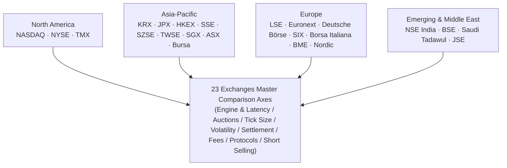
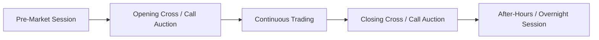
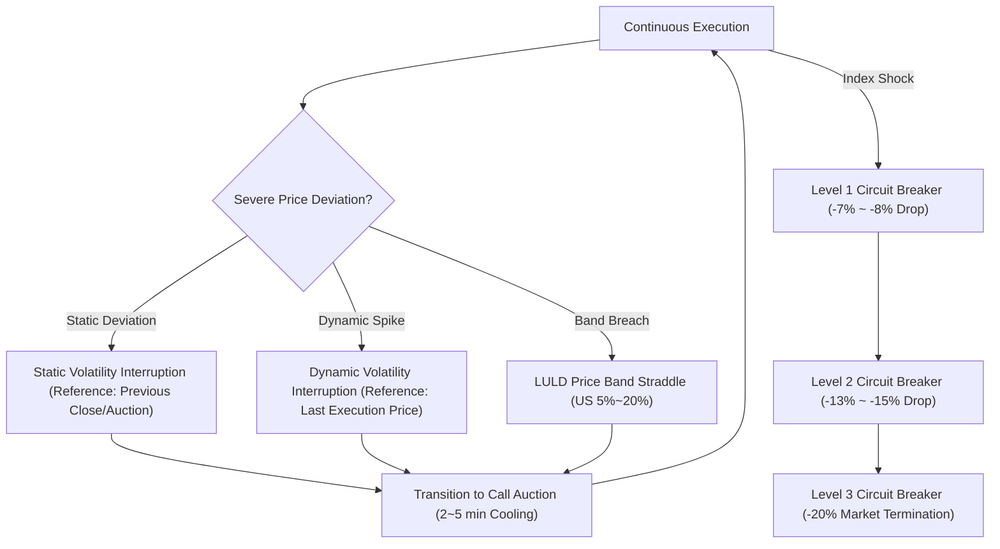
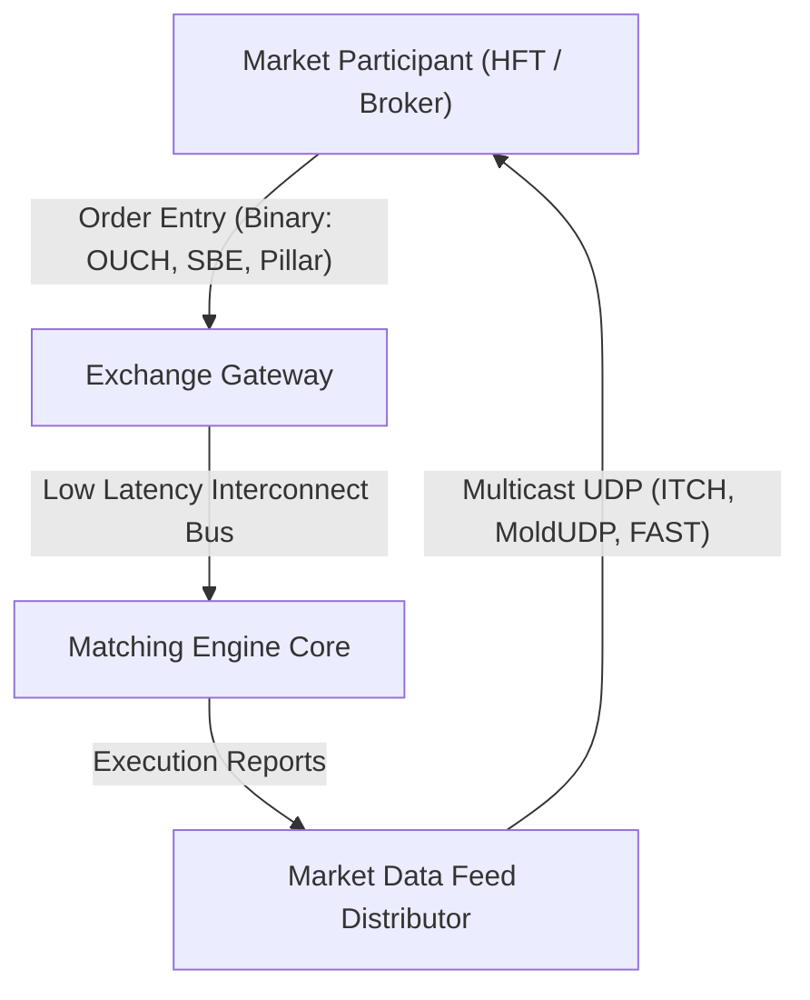

# 23 Global Exchanges Comprehensive Comparison Matrix

> **Last Updated:** 2026-10-22  
> **Research Grade:** Tier 1 Comprehensive Benchmark  
> **Scope:** 23 Global Stock Exchanges & Major Derivatives / Options Systems across North America, APAC, Europe, and Middle East / Emerging Markets  

---

## 1. Executive Summary & Architecture Scope

Modern electronic equity and derivatives markets compete in microsecond (µs) and nanosecond (ns) regimes powered by ultra-low-latency fiber networks, data center co-location, FPGA hardware parsing, and deterministic in-memory matching engines.
This report delivers an exhaustive cross-comparison of 23 global exchanges across **matching engine architectures, core round-trip latency, continuous and auction session dynamics, tick size regimes, volatility safeguards (VI / LULD), settlement cycles (T+1 vs T+2), maker-taker fee structures, and binary trading protocols**.

---

## 2. Matching Engine Architectures & Core Latency Benchmarks

| Exchange | Platform Name | Vendor / Developer | Core Round-trip Latency (RTT) | Architectural Highlights & Hardware Acceleration |
|---|---|---|---|---|
| **NASDAQ** | INET / Eqlipse (4th Gen) | Proprietary (Nasdaq Tech) | **< 15 µs** (OUCH Native) | FPGA market data broadcast, microservices, AWS Outposts hybrid cloud integration |
| **NYSE** | Pillar Engine | Proprietary (ICE) | **< 20 µs** | Deterministic single-thread matching queue, in-memory sequencing |
| **TMX (TSX)** | TSX Quantum | Proprietary | **~ 35 µs** | Linux x86 multi-threaded distributed order queue |
| **KRX** | Exture 3.0 | Koscom (Proprietary) | **< 50 µs** | In-memory processing, Linux x86 cluster, low-latency kernel bypass |
| **JPX (Tokyo)** | Arrowhead 4.0 | Fujitsu | **< 100 µs** | Ultra-reliable non-stop triple cluster, microsecond quote distribution |
| **HKEX** | OTP-C (Orion Trading) | Proprietary | **< 80 µs** | Modular partitioning, OCG binary protocol gateway |
| **SSE (Shanghai)** | New Generation | Proprietary | **~ 150 µs** | High-throughput distributed queueing designed for extreme retail spikes |
| **SZSE (Shenzhen)**| 5th Gen Trading System | Proprietary | **~ 120 µs** | Parallel distributed node matching engine handling hundreds of thousands TPS |
| **TWSE** | Continuous Trading Sys | Proprietary | **< 100 µs** | Continuous execution architecture upgraded since 2020 transition |
| **SGX** | SGX Titan Engine | Nasdaq INET Platform | **< 30 µs** | High-speed integrated derivatives and equity matching infrastructure |
| **ASX** | ASX Trade & NTP | Nasdaq INET Platform | **< 40 µs** | ITCH multicast full-depth order book broadcasting |
| **Bursa Malaysia** | BTS2 Engine | MillenniumIT | **~ 80 µs** | LSEG technology distributed matching framework |
| **LSE** | Millennium Exchange | LSEG (MillenniumIT) | **< 25 µs** | High-performance C++ matching engine, shared memory ring buffers |
| **Euronext** | Optiq Platform | Proprietary | **< 15 µs** | Simple Binary Encoding (SBE), FPGA gateway acceleration |
| **Deutsche Börse** | T7 Architecture | Proprietary | **< 20 µs** | Hybrid cash and derivatives pipeline, shared Eurex architecture |
| **SIX Swiss** | SwissAtMid & OREX | Nasdaq INET Based | **< 30 µs** | High-speed co-matching of lit book and dark midpoint orders |
| **Borsa Italiana** | Optiq Engine | Euronext Migration | **< 15 µs** | Fully unified Pan-European Optiq matching engine |
| **BME (Spain)** | SIBE System | SIX Group Integration | **~ 60 µs** | Integrated electronic book linking Spain's four regional bourses |
| **Nasdaq Nordic** | INET Nordic | Nasdaq Tech | **< 20 µs** | Single consolidated order book across four Nordic countries |
| **NSE India** | NEAT+ Platform | Proprietary | **~ 80 µs** | Massive distributed network supporting over 200,000 terminals across India |
| **BSE** | BOLT Plus | Deutsche Börse T7 License | **< 20 µs** | Ultra-low latency T7 platform delivering India's fastest execution speed |
| **JSE** | MillenniumIT | LSEG Technology | **~ 70 µs** | High-capacity infrastructure serving Africa's primary liquidity center |
| **Saudi Tadawul** | Nasdaq X-Stream | Nasdaq Tech | **< 40 µs** | MENA region's leading integrated equity and derivatives engine |

---

## 3. Trading Sessions & Auction Mechanics

### Trading Session Specification Matrix

| Exchange | Regular Trading Hours (Local) | Regular Hours (UTC) | Lunch Break | Opening Auction | Closing Auction | 24-Hour / Overnight Sessions |
|---|---|---|---|---|---|---|
| **NASDAQ** | 09:30 - 16:00 ET | 13:30 - 20:00 UTC | **None** | 09:30 (Opening Cross) | 16:00 (Closing Cross) | **Supported (23-Hour Overnight Session)** |
| **NYSE** | 09:30 - 16:00 ET | 13:30 - 20:00 UTC | **None** | 09:30 (DMM Facilitated) | 16:00 (Closing Cross) | **Supported (22-23 Hour Extended Session)** |
| **TMX** | 09:30 - 16:00 ET | 13:30 - 20:00 UTC | **None** | 09:30 | 16:00 | Standard after-hours only |
| **KRX** | 09:00 - 15:30 KST | 00:00 - 06:30 UTC | **None** | 08:30-09:00 (30m call) | 15:20-15:30 (10m call) | Extended single-price (~18:00), Nextrade ATS integration |
| **JPX** | 09:00 - 15:30 JST | 00:00 - 06:30 UTC | **Yes (11:30 - 12:30)** | 09:00 (Itayose) | 15:30 (Extended in 2024) | Night derivatives session only |
| **HKEX** | 09:30 - 16:00 HKT | 01:30 - 08:00 UTC | **Yes (12:00 - 13:00)** | 09:00 - 09:20 (POS) | 16:00 - 16:10 (CAS) | T+1 night futures trading |
| **SSE / SZSE** | 09:30 - 15:00 CST | 01:30 - 07:00 UTC | **Yes (11:30 - 13:00)** | 09:15 - 09:25 | 14:57 - 15:00 | Not supported |
| **TWSE** | 09:00 - 13:30 CST | 01:00 - 05:30 UTC | **None** | 08:30 - 09:00 | 13:25 - 13:30 | After-hours fixed price trading |
| **SGX** | 09:00 - 17:00 SGT | 01:00 - 09:00 UTC | **None (Abolished)** | 08:30 - 09:00 | 17:00 - 17:06 | 24-hour global futures linkage |
| **ASX** | 10:00 - 16:00 AEST | 00:00 - 06:00 UTC | **None** | 10:00 (15s random end) | 16:00 (15s random end) | Not supported |
| **LSE** | 08:00 - 16:30 GMT | 08:00 - 16:30 UTC | **None** | 07:50 - 08:00 | 16:30 - 16:35 | International order book session |
| **Euronext** | 09:00 - 17:30 CET | 08:00 - 16:30 UTC | **None** | 07:15 - 09:00 | 17:30 - 17:35 | Trading At Last (TAL) session |
| **Deutsche Börse**| 09:00 - 17:30 CET | 08:00 - 16:30 UTC | **None (Mid-day 13:00)**| 08:50 - 09:00 | 17:30 - 17:35 | Xetra pre-market and post-market |
| **NSE / BSE** | 09:15 - 15:30 IST | 03:45 - 10:00 UTC | **None** | 09:00 - 09:15 | 15:30 - 15:40 | Block deal windows |
| **Tadawul** | 10:00 - 15:00 AST | 07:00 - 12:00 UTC | **None** | 09:30 - 10:00 | 15:00 - 15:10 | Post-close trading |

---

## 4. Tick Size Regimes & Sub-Penny Schemes

| Exchange / Market | Regulatory Standard | Tick Size Structure (MPV) | Sub-Penny / Sub-Tick Status |
|---|---|---|---|
| **US (NASDAQ / NYSE)** | SEC Regulation NMS (Amended Rule 612) | Price >= 1.00 USD: **0.01 USD** (High-liquidity tier: **0.005 USD** half-penny) Price < 1.00 USD: **0.0001 USD** | Sub-tick midpoint executions and Price Improving Orders (PIO) allowed |
| **South Korea (KRX)** | KRX Regulations Article 32 | Price-tiered 7-step scale: - < 2,000 KRW: **1 KRW** - < 5,000 KRW: **5 KRW** - < 20,000 KRW: **10 KRW** - < 50,000 KRW: **50 KRW** - < 200,000 KRW: **100 KRW** - < 500,000 KRW: **500 KRW** - >= 500,000 KRW: **1,000 KRW** | Sub-tick entry strictly prohibited; midpoint matching allowed |
| **Japan (JPX)** | TSE Trading Rules | TOPIX 100 constituents: **Decimal Ticks** - <= 1,000 JPY: **0.1 JPY** - <= 3,000 JPY: **0.5 JPY** - <= 10,000 JPY: **1 JPY** | Stepped ticks for non-TOPIX 100 securities |
| **Hong Kong (HKEX)** | Second Schedule Spread Table | 13 price-tiered steps: - 0.01 to 0.25 HKD: **0.001 HKD** - 0.25 to 0.50 HKD: **0.005 HKD** - 0.50 to 10.00 HKD: **0.01 HKD** - 10.00 to 20.00 HKD: **0.02 HKD** - 100 to 200 HKD: **0.10 HKD** | Strict adherence required; no sub-spread display |
| **Europe (LSE / Euronext / DB)**| MiFID II RTS 28 (Liquidity Bands) | 6 ADNT liquidity bands x 19 price tiers = **114-cell dynamic matrix** | Strict enforcement across all European trading venues |

---

## 5. Volatility Safeguards (Price Limits & Circuit Breakers)

### Volatility Controls Comparison Matrix

| Exchange | Daily Price Limits | Single-Stock Volatility Interruption | Market-Wide Circuit Breakers (MWCB) |
|---|---|---|---|
| **NASDAQ / NYSE** | **None** | **Limit Up-Limit Down (LULD):** 5-minute rolling reference band (±5% ~ 20%). 15-second straddle triggers 5-minute trading pause | **S&P 500 Index Triggers:** - L1: -7% (15-min halt) - L2: -13% (15-min halt) - L3: -20% (Full day termination) |
| **KRX** | **±30%** (Upper/Lower limits) | **Static & Dynamic VI:** - Dynamic VI: 2~6% price shock triggers 2-min call auction - Static VI: 10% deviation triggers 2-min call auction | **KOSPI / KOSDAQ Index Triggers:** - Level 1: -8% (20m halt + 10m auction) - Level 2: -15% (20m halt + 10m auction) - Level 3: -20% (Full day termination) |
| **JPX** | Fixed nominal bands by price bracket | **Special Quote (Tokubetsu Kehai):** Price deviation beyond renewal limits pauses continuous trading and enters 3-minute iterative auction | TOPIX and futures linked trading halts (10~15 minutes) |
| **HKEX** | **None** | **Volatility Control Mechanism (VCM):** ±10% deviation from 5-min reference price triggers 5-min cooling-off period | No market-wide CB (handled via individual VCMs) |
| **SSE / SZSE** | **±10%** (Standard), **±20%** (ChiNext/STAR) | Orders restricted once price reaches statutory limit | Limit-up/limit-down structure enforces order bounds |
| **LSE** | **None** | **Circuit Breaker Auction:** Breaching static/dynamic corridor initiates 5-minute call auction | Automatic auction call sessions on index-level shocks |
| **Euronext** | **None** | **Collar / Reserving Mechanism:** Static ±10%, dynamic ±2~5% triggers reservation phase and auction | Coordinated pan-European index circuit breaker |
| **Deutsche Börse**| **None** | **Volatility Interruption (Volaint):** Breach of dynamic or static corridor pauses trading for 2-minute auction | Xetra emergency halt protocols |
| **NSE / BSE** | Single-stock bands: 2%, 5%, 10%, 20% | Orders outside band rejected by gateway | **Nifty 50 Index Triggers:** 10%, 15%, 20% staged market halts |

---

## 6. Clearing, Settlement Cycles & Central Counterparties (CCP)

| Country / Exchange | Settlement Cycle | Accelerated T+1 Implementation | Central Counterparty (CCP) | Central Securities Depository (CSD) |
|---|---|---|---|---|
| **United States (NASDAQ/NYSE)** | **T+1** | **Completed May 28, 2024** | NSCC (DTCC subsidiary) | DTC (DTCC subsidiary) |
| **Canada (TMX)** | **T+1** | **Completed May 27, 2024** | CDS Clearing | CDS (TMX Group) |
| **India (NSE/BSE)** | **T+1** (Optional **T+0** pilot) | **Fully deployed January 2023** | NCL / ICCL | NSDL / CDSL |
| **South Korea (KRX)** | **T+2** (Roadmap underway) | Maintained at T+2 | KRX Clearing | KSD (Korea Securities Depository) |
| **Europe (LSE / Euronext / DB)**| **T+2** (Targeting 2027 T+1) | Joint EU/UK accelerated task force | EuroCCP, LCH, Eurex Clearing | Euroclear, Clearstream |
| **Japan (JPX)** | **T+2** (Working group active) | Maintained at T+2 | JSCC | JASDEC |
| **Hong Kong (HKEX)** | **T+2** | Maintained at T+2 | HKSCC | HKSCC |
| **China (SSE/SZSE)** | **T+1 (Securities) / T+0 (Cash)** | Unique dual-speed settlement | CSDC | CSDC |

---

## 7. Fee Schedules & Maker-Taker Rebate Dynamics

| Exchange | Fee Paradigm | Liquidity Adding (Maker) Rebate | Liquidity Removing (Taker) Fee | Distinctive Fee Incentives |
|---|---|---|---|---|
| **NASDAQ** | **Maker-Taker (Invertible)** | **Up to (0.00305 USD) credit** | **0.0030 USD standard** | Supplementary credits for M-ELO; QMM tiered rewards |
| **NYSE** | **Maker-Taker (Classic)** | **Up to (0.0032 USD) credit** | **0.0030 USD standard** | Designated Market Maker (DMM) preferential brackets |
| **KRX** | **Hybrid (Maker-Taker launched 2025)** | **Spread-improving rebates** | Value-based fee schedule | Spread-tightening rebates responding to Nextrade ATS competition |
| **HKEX** | **Value-based flat rate** | None (MM incentives only) | **0.00565%** of value | Ad valorem stamp duty (0.1%) separately collected |
| **JPX** | **Value-based + MM scheme** | Quarterly performance grants | Value-based schedule | TOPIX 100 liquidity provider tax credits |
| **LSE** | **Hybrid Maker-Taker** | High-volume passive rebates | Fixed basis point taker fee | Dedicated small-cap liquidity provisioning rebates |
| **Euronext** | **Optiq sliding tariff** | Passive fee discount/credit | Tiered value and contract fee | Active trader monthly volume discounts |
| **Deutsche Börse**| **T7 Tiered model** | Passive execution fee waiver | Tiered by liquidity bracket | Bundled monthly enterprise access options |

---

## 8. Gateway Protocols & Network Infrastructure

| Exchange | Native Order Protocol | Market Data Distribution Feed | Standard Industry Gateway | Primary Co-location Facility |
|---|---|---|---|---|
| **NASDAQ** | **OUCH 5.0** (Binary) | **TotalView-ITCH 5.0** (Multicast) | FIX 4.2 / 5.0 | **Carteret, New Jersey (NY11)** |
| **NYSE** | **Pillar Binary Gateway** | **NYSE Integrated Feed (XDP)** | FIX 4.2 / 5.0 | **Mahwah, New Jersey Data Center** |
| **TMX** | **Quantum Binary** | **TSX Level 2 Multicast** | FIX 4.2 | **TMX Data Centre, Toronto** |
| **KRX** | **Exture Binary Messages** | **K-Direct Multicast Feed** | FIX 4.4 | **Yeouido / Busan Data Centers, Korea** |
| **JPX** | **Arrowhead Native Binary** | **FLEX Full-depth Feed** | FIX 4.4 / 5.0 | **CC2 (Toyosu / Inzai), Tokyo** |
| **HKEX** | **OCG Binary Interface** | **OMD-C (Orion Market Data)** | FIX 4.2 | **Tseung Kwan O (TKO), Hong Kong** |
| **LSE** | **Native Trading Gateway (NTG)** | **MITCH / Group Ticker Plant (GTP)** | FIX 5.0 SP2 | **Equinix LD4 (Slough) / Docklands, UK** |
| **Euronext** | **Optiq OEG (SBE Binary)** | **Optiq MDG (Multicast SBE)** | FIX 5.0 | **Aruba IT3 Data Center, Bergamo, Italy** |
| **Deutsche Börse**| **T7 ETI (Enhanced Interface)** | **T7 EMDI / EOBI (Ultra-low latency unrolled)** | FIX 5.0 SP2 | **Equinix FR2, Frankfurt, Germany** |
| **SIX Swiss** | **OUCH-based Binary** | **ITCH Feed** | FIX 4.4 | **Equinix ZH4, Zurich, Switzerland** |

---

## 9. Comprehensive Master Benchmark Summary

| Exchange | Country | Benchmark Index | Matching Engine | RTT | Tick Size Regime | Daily Limit | Settlement | Fee Paradigm |
|---|---|---|---|---|---|---|---|---|
| **NASDAQ** | 🇺🇸 United States | Nasdaq 100 | INET/Eqlipse | <15µs | Reg NMS (0.01 / 0.005 USD) | Unlimited (LULD) | T+1 | Maker-Taker |
| **NYSE** | 🇺🇸 United States | S&P 500, DJIA | Pillar | <20µs | Reg NMS (0.01 / 0.005 USD) | Unlimited (LULD) | T+1 | Maker-Taker |
| **TMX** | 🇨🇦 Canada | S&P/TSX 60 | Quantum | ~35µs | 0.005 / 0.01 CAD | Unlimited | T+1 | Maker-Taker |
| **KRX** | 🇰🇷 South Korea | KOSPI 200 | Exture 3.0 | <50µs | 7-step scale (1~1000 KRW) | ±30% | T+2 | Hybrid |
| **JPX** | 🇯🇵 Japan | Nikkei 225, TOPIX | Arrowhead 4.0 | <100µs | TOPIX 100 Decimal Ticks | Price-banded | T+2 | Value-based |
| **HKEX** | 🇭🇰 Hong Kong | Hang Seng (HSI) | OTP-C | <80µs | 13-step spread table | Unlimited (VCM) | T+2 | Value-based |
| **SSE** | 🇨🇳 China | SSE Composite | New Gen | ~150µs | 0.01 CNY fixed | ±10% / ±20% | T+1 | Flat rate |
| **SZSE** | 🇨🇳 China | SZSE Component | 5th Gen | ~120µs | 0.01 CNY fixed | ±10% / ±20% | T+1 | Flat rate |
| **TWSE** | 🇹🇼 Taiwan | TAIEX | Continuous | <100µs | 6-step scale | ±10% | T+2 | Flat rate |
| **SGX** | 🇸🇬 Singapore | STI Index | Titan (INET) | <30µs | 0.001 ~ 0.01 SGD | Unlimited | T+2 | Value-based |
| **ASX** | 🇦🇺 Australia | S&P/ASX 200 | Trade (INET) | <40µs | 3-step scale | Unlimited | T+2 | Hybrid |
| **Bursa** | 🇲🇾 Malaysia | KLCI | BTS2 (MIT) | ~80µs | 3-step scale | ±30% | T+2 | Value-based |
| **LSE** | 🇬🇧 United Kingdom | FTSE 100 | Millennium | <25µs | MiFID II RTS 28 bands | Unlimited (Auctions)| T+2 | Maker-Taker |
| **Euronext** | 🇪🇺 Pan-Europe | CAC 40, AEX | Optiq | <15µs | MiFID II RTS 28 bands | Unlimited (Collars) | T+2 | Hybrid |
| **Deutsche Börse**| 🇩🇪 Germany | DAX 40 | T7 Architecture| <20µs | MiFID II RTS 28 bands | Unlimited (Volaint) | T+2 | Tiered |
| **SIX** | 🇨🇭 Switzerland | SMI Index | SwissAtMid | <30µs | MiFID II aligned bands| Unlimited | T+2 | Hybrid |
| **Borsa Italiana**| 🇮🇹 Italy | FTSE MIB | Optiq | <15µs | MiFID II RTS 28 bands | Unlimited | T+2 | Hybrid |
| **BME** | 🇪🇸 Spain | IBEX 35 | SIBE | ~60µs | MiFID II RTS 28 bands | Unlimited | T+2 | Value-based |
| **Nasdaq Nordic** | 🇸🇪 Nordic | OMXS30 | INET Nordic | <20µs | MiFID II RTS 28 bands | Unlimited | T+2 | Maker-Taker |
| **NSE India** | 🇮🇳 India | Nifty 50 | NEAT+ | ~80µs | 0.05 INR fixed | ±10% ~ 20% | T+1 | Value-based |
| **BSE** | 🇮🇳 India | Sensex | BOLT+ (T7) | <20µs | 0.05 INR fixed | ±10% ~ 20% | T+1 | Value-based |
| **JSE** | 🇿🇦 South Africa | FTSE/JSE Top 40| MillenniumIT | ~70µs | Stepped scale | Unlimited | T+2 | Hybrid |
| **Tadawul** | 🇸🇦 Saudi Arabia | TASI | X-Stream | <40µs | 0.01 ~ 0.02 SAR | ±10% | T+2 | Value-based |
