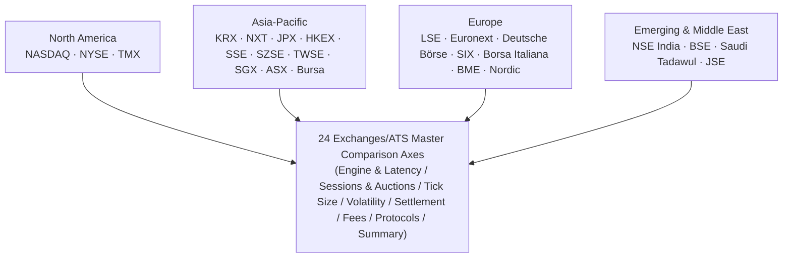
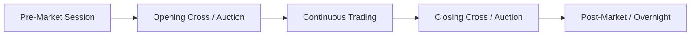
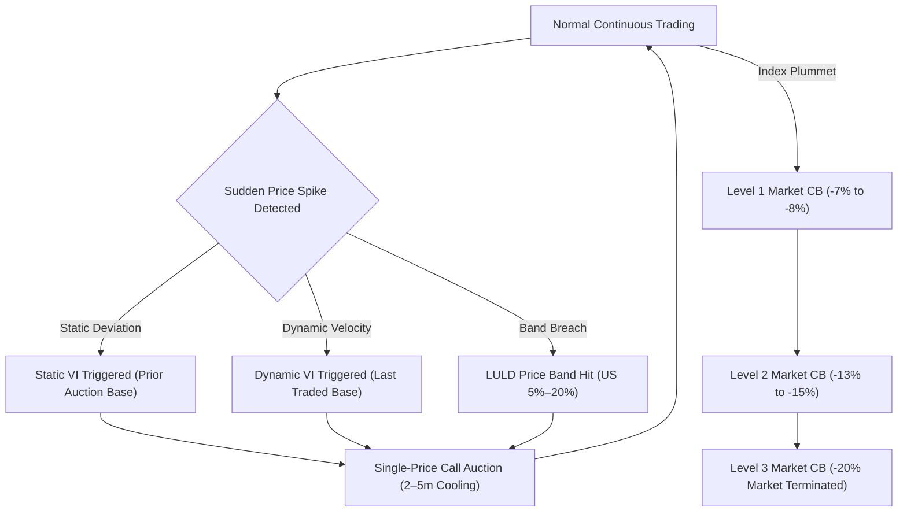
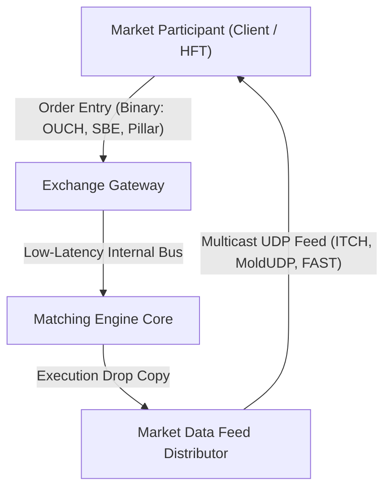

# 24 Global Exchanges & ATS Comprehensive Comparison Matrix

> **Last Updated:** 2026-10-22  
> **Research Grade:** Tier 1 Comprehensive Benchmark  
> **Scope:** 24 Global Stock Exchanges & Alternative Trading Systems (ATS) across North America, APAC, Europe, and Middle East / Emerging Markets  

---

## 1. Executive Summary & Architecture Scope

Modern electronic equity and derivatives markets compete in microsecond (µs) and nanosecond (ns) regimes powered by ultra-low-latency fiber networks, data center co-location, FPGA hardware parsing, and deterministic in-memory matching engines.
This report delivers an exhaustive cross-comparison of 24 global exchanges and Alternative Trading Systems (ATS) across **matching engine architectures, core round-trip latency, continuous and auction session dynamics, tick size regimes, volatility safeguards (VI / LULD), settlement cycles (T+1 vs T+2), maker-taker fee structures, and binary trading protocols**.

---

## 2. Matching Engine Architectures & Core Latency Benchmarks

| Exchange | Platform Name | Vendor / Developer | Core Round-trip Latency (RTT) | Architectural Highlights & Hardware Acceleration |
|---|---|---|---|---|
| **NASDAQ** | INET / Eqlipse (4th Gen) | Proprietary (Nasdaq Tech) | **< 15 µs** (OUCH Native) | FPGA market data broadcast, microservices, AWS Outposts hybrid cloud integration |
| **NYSE** | Pillar Engine | Proprietary (ICE) | **< 20 µs** | Deterministic single-thread matching queue, in-memory sequencing |
| **TMX (TSX)** | TSX Quantum | Proprietary | **~ 35 µs** | Linux x86 multi-threaded distributed order queue |
| **KRX** | Exture 3.0 | Koscom (Proprietary) | **< 50 µs** | In-memory processing, Linux x86 cluster, low-latency kernel bypass |
| **Nextrade (NXT)** | NextStation Platform | Koscom (ATS Optimized) | **< 30 µs** | In-memory ultra-low-latency matching, K-SOR integration, dedicated Midpoint/Stop queues |
| **JPX (Tokyo)** | Arrowhead 4.0 | Fujitsu | **< 100 µs** | Ultra-reliable non-stop triple cluster, microsecond quote distribution |
| **HKEX** | OTP-C (Orion Trading) | Proprietary | **< 80 µs** | Modular partitioning, OCG binary protocol gateway |
| **SSE (Shanghai)** | New Generation | Proprietary | **~ 150 µs** | High-throughput distributed queueing designed for extreme retail spikes |
| **SZSE (Shenzhen)**| 5th Gen Trading System | Proprietary | **~ 120 µs** | Parallel distributed node matching engine handling hundreds of thousands TPS |
| **TWSE** | Continuous Trading Sys | Proprietary | **< 100 µs** | Continuous execution architecture upgraded since 2020 transition |
| **SGX** | SGX Titan Engine | Nasdaq INET Platform | **< 30 µs** | High-speed integrated derivatives and equity matching infrastructure |
| **ASX** | ASX Trade & NTP | Nasdaq INET Platform | **< 40 µs** | ITCH multicast full-depth order book broadcasting |
| **Bursa Malaysia** | BTS2 Engine | MillenniumIT | **~ 80 µs** | LSEG technology distributed matching framework |
| **LSE** | Millennium Exchange | LSEG (MillenniumIT) | **< 25 µs** | High-performance C++ matching engine, shared memory ring buffers |
| **Euronext** | Optiq Platform | Proprietary | **< 15 µs** | Simple Binary Encoding (SBE), FPGA gateway acceleration |
| **Deutsche Börse** | T7 Architecture | Proprietary | **< 20 µs** | Hybrid cash and derivatives pipeline, shared Eurex architecture |
| **SIX Swiss** | SwissAtMid & OREX | Nasdaq INET Based | **< 30 µs** | High-speed co-matching of lit book and dark midpoint orders |
| **Borsa Italiana** | Optiq Engine | Euronext Unified | **< 15 µs** | Full migration to Euronext Optiq multi-market core platform |
| **BME (Spain)** | SIBE System | SIX Group Integration | **~ 60 µs** | Unified central electronic book connecting 4 Spanish exchanges |
| **Nasdaq Nordic** | INET Nordic | Nasdaq Tech | **< 20 µs** | Integrated matching framework covering Nordic markets |
| **NSE India** | NEAT+ Platform | Proprietary | **~ 80 µs** | Scaled distributed transaction network across 200,000+ trading terminals |
| **BSE (Bombay)** | BOLT Plus | Deutsche Börse T7 License| **< 20 µs** | Sub-millisecond high-speed execution engine licensed from T7 |
| **JSE** | MillenniumIT | LSEG License | **~ 70 µs** | Specialized market infrastructure for Pan-African capital liquidity |
| **Saudi Tadawul** | Nasdaq X-Stream | Nasdaq Tech | **< 40 µs** | High-capacity multi-asset engine serving GCC capital flows |

---

## 3. Trading Sessions & Auction Mechanisms

### Session Characteristics

| Exchange | Regular Hours (Local) | Regular Hours (KST) | Lunch Break | Opening Auction | Closing Auction | Extended / 24h Trading |
|---|---|---|---|---|---|---|
| **NASDAQ** | 09:30 - 16:00 | 22:30 - 05:00 (EDT) | **None** | 09:30 (Opening Cross) | 16:00 (Closing Cross) | **Supported (23-hour trading)** |
| **NYSE** | 09:30 - 16:00 | 22:30 - 05:00 (EDT) | **None** | 09:30 (DMM Auction) | 16:00 (Closing Cross) | **Supported (22-23h trading)** |
| **TMX** | 09:30 - 16:00 | 22:30 - 05:00 | **None** | 09:30 | 16:00 | Post-market only |
| **KRX** | 09:00 - 15:30 | 09:00 - 15:30 | **None** | 08:30-09:00 (30m collection)| 15:20-15:30 (10m collection)| Off-hours single price (~18:00), Nextrade ATS link |
| **Nextrade (NXT)**| **09:00:30 - 15:20** | **09:00:30 - 15:20** | **Session Breaks (08:50~09:00:30, 15:20~15:30)** | None (KRX Open Focus) | Closing Price (15:30~16:00 KRX close match) | **08:00~20:00 (12-hour continuous)** |
| **JPX** | 09:00 - 15:30 | 09:00 - 15:30 | **Yes (11:30 - 12:30)** | 09:00 (Itayose) | 15:30 (Extended in 2024) | Night derivatives only |
| **HKEX** | 09:30 - 16:00 | 10:30 - 17:00 | **Yes (12:00 - 13:00)** | 09:00 - 09:20 (POS) | 16:00 - 16:10 (CAS) | T+1 night futures session |
| **SSE / SZSE** | 09:30 - 15:00 | 10:30 - 16:00 | **Yes (11:30 - 13:00)** | 09:15 - 09:25 | 14:57 - 15:00 | Not supported |
| **TWSE** | 09:00 - 13:30 | 10:00 - 14:30 | **None** | 08:30 - 09:00 | 13:25 - 13:30 | Off-hours fixed price trading |
| **SGX** | 09:00 - 17:00 | 10:00 - 18:00 | **None (Lunch break abolished)**| 08:30 - 09:00 | 17:00 - 17:06 | Global futures 24h linked |
| **ASX** | 10:00 - 16:00 | 08:00 - 14:00 (AEST) | **None** | 10:00 (15s random close)| 16:00 (15s random close)| Not supported |
| **LSE** | 08:00 - 16:30 | 16:00 - 00:30 (BST) | **None** | 07:50 - 08:00 | 16:30 - 16:35 | International Order Book (IOB) |
| **Euronext** | 09:00 - 17:30 | 16:00 - 00:30 | **None** | 07:15 - 09:00 | 17:30 - 17:35 | Trading At Last (TAL) |
| **Deutsche Börse**| 09:00 - 17:30 | 16:00 - 00:30 | **None (Intraday Auction 13:00)**| 08:50 - 09:00 | 17:30 - 17:35 | Xetra pre/post sessions |
| **NSE / BSE** | 09:15 - 15:30 | 12:45 - 19:00 | **None** | 09:00 - 09:15 | 15:30 - 15:40 | Block deal window |
| **Tadawul** | 10:00 - 15:00 | 16:00 - 21:00 | **None** | 09:30 - 10:00 | 15:00 - 15:10 | Trade-at-last session |

---

## 4. Tick Size Regimes & Sub-Penny Regulations

| Exchange / Market | Regulatory Standard | Minimum Price Variation (Tick Schedules) | Sub-Penny / Sub-Tick Capability |
|---|---|---|---|
| **US (NASDAQ / NYSE)** | SEC Reg NMS (Rule 612 Modernization) | Stocks ≥ 1.00 USD: **0.01 USD** (Half-penny **0.005 USD** for designated high-liquidity names) Stocks < 1.00 USD: **0.0001 USD** | Sub-penny dark midpoint and PIO options matching permitted |
| **South Korea (KRX)** | KRX Business Regulations Art. 32 | 7 tiered step bands: - < 2,000 KRW: **1 KRW** - < 5,000 KRW: **5 KRW** - < 20,000 KRW: **10 KRW** - < 50,000 KRW: **50 KRW** - < 200,000 KRW: **100 KRW** - < 500,000 KRW: **500 KRW** - ≥ 500,000 KRW: **1,000 KRW** | Order entry prohibited at sub-tick; midpoint execution permitted |
| **South Korea (Nextrade ATS)**| Nextrade Operating Regulations | Adheres to KRX 7 tiered step bands (1 to 1,000 KRW) | **Midpoint orders execute at half-tick (0.5 tick) granularity** |
| **Japan (JPX)** | TSE Trading Rules | TOPIX 100 constituents: **Decimal Tick** regime - ≤ 1,000 JPY: **0.1 JPY** - ≤ 3,000 JPY: **0.5 JPY** - ≤ 10,000 JPY: **1 JPY** | Non-TOPIX 100 names adhere to standard tiered tables |
| **Hong Kong (HKEX)** | Second Schedule Spread Table | 13 price tiers: - 0.01–0.25 HKD: **0.001 HKD** - 0.25–0.50 HKD: **0.005 HKD** - 0.50–10.00 HKD: **0.01 HKD** - 10.00–20.00 HKD: **0.02 HKD** - 100–200 HKD: **0.10 HKD** | Strictly enforced spread adherence |
| **Europe (LSE / Euronext / DB)**| MiFID II RTS 28 Liquidity Bands | 6 Average Daily Number of Transactions (ADNT) bands × 19 price ranges = **114-cell dynamic matrix** | Sub-tick order entries rejected |

---

## 5. Price Volatility Safeguards & Circuit Breakers

### Detailed Volatility Protection Matrix

| Exchange | Single Stock Daily Limit | Single Stock Volatility Interruption | Market-wide Circuit Breaker (MWCB) |
|---|---|---|---|
| **NASDAQ / NYSE** | **None (No daily price limits)** | **LULD (Limit Up-Limit Down):** ±5% to 20% band based on trailing 5-minute average; 15-second straddle triggers 5-minute pause | **S&P 500 Benchmarks:** - L1: -7% (15-min halt) - L2: -13% (15-min halt) - L3: -20% (Full day market close) |
| **KRX** | **±30%** (Daily static band) | **Static & Dynamic Volatility Interruption (VI):** - Dynamic VI: 2–6% sudden change triggers 2-min call auction - Static VI: 10% move triggers 2-min call auction | **KOSPI / KOSDAQ Index Benchmarks:** - Stage 1: -8% (20m halt + 10m auction) - Stage 2: -15% (20m halt + 10m auction) - Stage 3: -20% (Session terminated) |
| **Nextrade (NXT)**| **±30%** (Synchronized with KRX) | **Static & Dynamic VI Coordination:** Halts trading for 2 minutes during KRX VI auction to synchronize book | Synchronized 20-minute full trading halt when KRX triggers Market-wide CB |
| **JPX** | Fixed step boundaries based on prior close | **Special Quote (Tokuhai):** Triggers 3-minute iterative single-price auction if update interval exceeds limits | TOPIX & futures-linked market-wide circuit breakers (10–15 min pause) |
| **HKEX** | **None** | **Volatility Control Mechanism (VCM):** ±10% move over 5 minutes triggers 5-minute cooling-off within fixed corridor | No market-wide CB (addressed at individual stock VCM level) |
| **SSE / SZSE** | **±10%** (Main board), **±20%** (STAR/ChiNext)| Reaching ceiling/floor locks further trade matching outside band | Market-wide CB repealed; stabilized exclusively via price limit bands |
| **LSE** | **None** | **Circuit Breaker Auction:** Price exceeding static/dynamic tolerance corridors triggers 5-minute call auction | Automated auction calls triggered on extreme index declines |
| **Euronext** | **None** | **Collar / Reserving:** Static ±10%, dynamic ±2–5% breach enters reserving state and call auction | Pan-European index-coordinated pauses |
| **Deutsche Börse**| **None** | **Volatility Interruption (Volaint):** Dynamic/static corridor exit initiates 2-minute volatility auction | Xetra-level index circuit breakers |
| **NSE / BSE** | Tiered 2%, 5%, 10%, 20% bands per stock | Trading capped at circuit filter boundaries | **Nifty 50 Benchmarks:** Tiered halts at 10%, 15%, and 20% |

---

## 6. Settlement Cycles & Central Counterparties (CCP)

| Country / Exchange | Settlement Cycle | Mandate Implementation Date | Central Counterparty (CCP) | Central Securities Depository (CSD) |
|---|---|---|---|---|
| **United States (NASDAQ/NYSE)** | **T+1** | **Completed May 28, 2024** | NSCC (DTCC subsidiary) | DTC (DTCC subsidiary) |
| **Canada (TMX)** | **T+1** | **Completed May 27, 2024** | CDS Clearing | CDS (TMX Group) |
| **India (NSE/BSE)** | **T+1** (Beta **T+0** pilot) | **Full roll-out January 2023** | NCL / ICCL | NSDL / CDSL |
| **South Korea (KRX)** | **T+2** (T+1 roadmap under review) | Retains current T+2 | KRX Clearing Division | KSD (Korea Securities Depository) |
| **South Korea (Nextrade ATS)**| **T+2** (Unified with KRX) | Retains current T+2 | **KRX (Acts as CCP)** | **KSD (Korea Securities Depository)** |
| **Europe (LSE / Euronext / DB)**| **T+2** (Targeting T+1 by 2027) | UK/EU coordinated roadmap | EuroCCP, LCH, Eurex Clearing | Euroclear, Clearstream |
| **Japan (JPX)** | **T+2** (T+1 working group active) | Retains current T+2 | JSCC | JASDEC |
| **Hong Kong (HKEX)** | **T+2** | Retains current T+2 | HKSCC | HKSCC |
| **China (SSE/SZSE)** | **T+1 (Securities) / T+0 (Cash)** | Domestic specialized cycle | CSDC | CSDC |

---

## 7. Fee Schedules & Maker-Taker Economics

| Exchange | Dominant Fee Schedule | Passive Liquidity (Maker) Rebate | Aggressive Liquidity (Taker) Fee | Distinctive Fee Mechanics |
|---|---|---|---|---|
| **NASDAQ** | **Inverted / Classic Maker-Taker** | **Up to (0.00305 USD) credit per share** | **0.0030 USD fee per share** | M-ELO supplementary credits, QMM tiered rebate tiers |
| **NYSE** | **Classic Maker-Taker** | **Up to (0.0032 USD) credit per share** | **0.0030 USD fee per share** | Designated Market Maker (DMM) preferential tier bands |
| **KRX** | **Hybrid (Maker-Taker added 2025)** | **Rebates for quote spread compression** | Baseline value-based fee | Differentiated tariffs in response to Nextrade (NXT) competition |
| **Nextrade (NXT)**| **Maker-Taker Tiered Schedule** | **Maker: ~0.0013%** | **Taker: ~0.0018%** | **20% to 40% lower fees than KRX, driven by SOR optimization** |
| **HKEX** | **Value-based Ad Valorem** | None (MM spread incentives only) | **0.00565% ad valorem** | Stamp Duty (0.1%) collected concurrently |
| **JPX** | **Turnover-based + MM Incentive** | Quarterly MM liquidity subsidies | Standard turnover fee scale | Tax credits for designated TOPIX100 liquidity providers |
| **LSE** | **Maker-Taker + Value Hybrid** | Aggressive liquidity provider rebate | Fixed basis point taker fee | Dedicated liquidity support incentives for mid/small-cap tiers |
| **Euronext** | **Optiq Fixed + Sliding Scale** | Maker tariff discounts & credits | Stepped fee per order & volume | Active Trader monthly volume tiered discounts |
| **Deutsche Börse**| **T7 Tiered Volume Schedules** | Zero-fee brackets & liquidity credits | Tiered according to liquidity category| Bundled package subscription models |

---

## 8. Connectivity Protocols & Data Center Infrastructure

| Exchange | Native Order Protocol | Market Data Interface | Standard Protocol | Primary Data Center (Co-location) |
|---|---|---|---|---|
| **NASDAQ** | **OUCH 5.0** (Binary) | **TotalView-ITCH 5.0** (Multicast) | FIX 4.2 / 5.0 | **Carteret, New Jersey (NY11)** |
| **NYSE** | **Pillar Binary Gateway** | **NYSE Integrated Feed (XDP)** | FIX 4.2 / 5.0 | **Mahwah, New Jersey Data Center** |
| **TMX** | **Quantum Binary** | **TSX Level 2 Multicast** | FIX 4.2 | **TMX Data Centre, Toronto, Canada** |
| **KRX** | **Exture Binary Messages** | **K-Direct Multicast Feed** | FIX 4.4 | **Yeouido, Seoul / Busan HQ, South Korea**|
| **Nextrade (NXT)**| **Proprietary Binary Gateway** | **ITCH Multicast Feed** | FIX 4.2 / 4.4 | **Koscom Financial Cloud IDC, Yeouido, Seoul**|
| **JPX** | **Arrowhead Native Messages** | **FLEX Full-depth Feed** | FIX 4.4 / 5.0 | **CC2 (Toyosu / Inzai), Tokyo, Japan** |
| **HKEX** | **OCG Binary Interface** | **OMD-C (Orion Market Data)** | FIX 4.2 | **Tseung Kwan O (TKO), Hong Kong** |
| **LSE** | **Native Trading Gateway (NTG)** | **MITCH / Group Ticker Plant (GTP)** | FIX 5.0 SP2 | **Slough (LD4) / Docklands, London, UK** |
| **Euronext** | **Optiq OEG (SBE Binary)** | **Optiq MDG (Multicast SBE)** | FIX 5.0 | **Aruba IT3, Bergamo, Italy** |
| **Deutsche Börse**| **T7 ETI (Enhanced Trading Interface)** | **T7 EMDI / EOBI (Unrolled Order Feed)**| FIX 5.0 SP2 | **Equinix FR2, Frankfurt, Germany** |
| **SIX Swiss** | **OUCH-derived Binary** | **ITCH Feed** | FIX 4.4 | **Equinix ZH4, Zurich, Switzerland** |

---

## 9. 24 Exchanges & ATS Master Specification Matrix

| Exchange | Country | Flagship Index | Matching Core | Latency | Tick Size Regime | Daily Limits | Clearing | Fee Model |
|---|---|---|---|---|---|---|---|---|
| **NASDAQ** | 🇺🇸 United States | Nasdaq 100 | INET/Eqlipse | <15µs | Reg NMS (0.01 / 0.005 USD) | Unlimited (LULD) | T+1 | Maker-Taker |
| **NYSE** | 🇺🇸 United States | S&P 500, DJIA | Pillar | <20µs | Reg NMS (0.01 / 0.005 USD) | Unlimited (LULD) | T+1 | Maker-Taker |
| **TMX** | 🇨🇦 Canada | S&P/TSX 60 | Quantum | ~35µs | 0.005 / 0.01 CAD | Unlimited | T+1 | Maker-Taker |
| **KRX** | 🇰🇷 South Korea | KOSPI 200 | Exture 3.0 | <50µs | 7 Step Tiers (1–1000 KRW) | ±30% | T+2 | Hybrid |
| **Nextrade (NXT)**| 🇰🇷 South Korea (ATS)| KOSPI/KOSDAQ 800 | NextStation | <30µs | KRX Tiers + Midpoint 0.5t | ±30% | T+2 | Maker-Taker (0.0013%/0.0018%) |
| **JPX** | 🇯🇵 Japan | Nikkei 225, TOPIX | Arrowhead 4.0 | <100µs | TOPIX100 Decimal Tick | Stepped limits | T+2 | Ad Valorem |
| **HKEX** | 🇭🇰 Hong Kong | Hang Seng (HSI) | OTP-C | <80µs | 13-tier Spread Table | Unlimited (VCM) | T+2 | Ad Valorem |
| **SSE** | 🇨🇳 China | SSE Composite | New Gen | ~150µs | 0.01 CNY fixed | ±10% / ±20% | T+1 | Flat Fee |
| **SZSE** | 🇨🇳 China | SZSE Component | 5th Gen | ~120µs | 0.01 CNY fixed | ±10% / ±20% | T+1 | Flat Fee |
| **TWSE** | 🇹🇼 Taiwan | TAIEX | Continuous | <100µs | 6 Step Tiers | ±10% | T+2 | Flat Fee |
| **SGX** | 🇸🇬 Singapore | STI Index | Titan (INET) | <30µs | 0.001 – 0.01 SGD | Unlimited | T+2 | Ad Valorem |
| **ASX** | 🇦🇺 Australia | S&P/ASX 200 | Trade (INET) | <40µs | 3 Step Tiers | Unlimited | T+2 | Hybrid |
| **Bursa** | 🇲🇾 Malaysia | KLCI | BTS2 (MIT) | ~80µs | 3 Step Tiers | ±30% | T+2 | Ad Valorem |
| **LSE** | 🇬🇧 United Kingdom| FTSE 100 | Millennium | <25µs | MiFID II RTS 28 Bands | Unlimited (Auctions) | T+2 | Maker-Taker |
| **Euronext** | 🇪🇺 Pan-Europe | CAC 40, AEX | Optiq | <15µs | MiFID II RTS 28 Bands | Unlimited (Collars) | T+2 | Hybrid |
| **Deutsche Börse**| 🇩🇪 Germany | DAX 40 | T7 Architecture| <20µs | MiFID II RTS 28 Bands | Unlimited (Volaint) | T+2 | Tiered |
| **SIX** | 🇨🇭 Switzerland | SMI Index | SwissAtMid | <30µs | MiFID II equivalent | Unlimited | T+2 | Hybrid |
| **Borsa Italiana**| 🇮🇹 Italy | FTSE MIB | Optiq | <15µs | MiFID II RTS 28 Bands | Unlimited | T+2 | Hybrid |
| **BME** | 🇪🇸 Spain | IBEX 35 | SIBE | ~60µs | MiFID II RTS 28 Bands | Unlimited | T+2 | Ad Valorem |
| **Nasdaq Nordic** | 🇸🇪 Nordic | OMXS30 | INET Nordic | <20µs | MiFID II RTS 28 Bands | Unlimited | T+2 | Maker-Taker |
| **NSE India** | 🇮🇳 India | Nifty 50 | NEAT+ | ~80µs | 0.05 INR fixed | ±10% to 20% | T+1 | Ad Valorem |
| **BSE** | 🇮🇳 India | Sensex | BOLT+ (T7) | <20µs | 0.05 INR fixed | ±10% to 20% | T+1 | Ad Valorem |
| **JSE** | 🇿🇦 South Africa | FTSE/JSE Top 40| MillenniumIT | ~70µs | Cent-denominated tiers | Unlimited | T+2 | Hybrid |
| **Tadawul** | 🇸🇦 Saudi Arabia | TASI | X-Stream | <40µs | 0.01 – 0.02 SAR | ±10% | T+2 | Ad Valorem |
