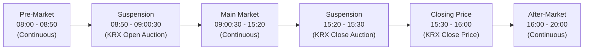
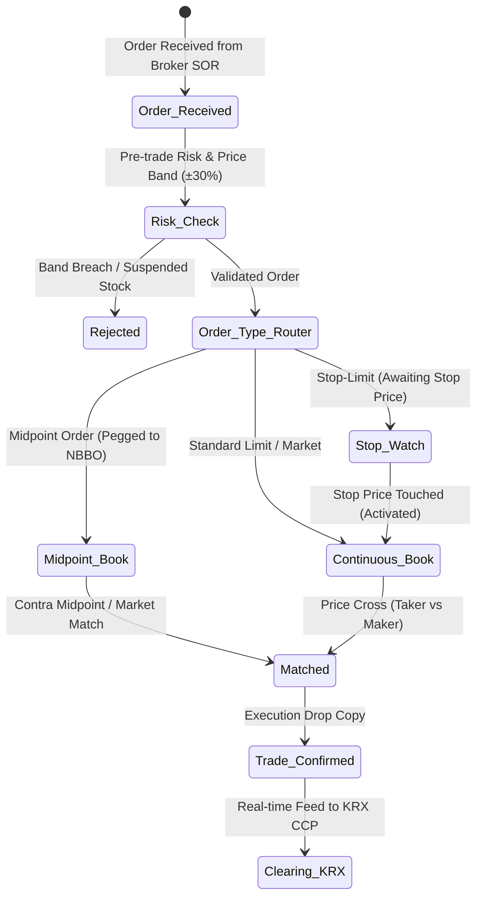
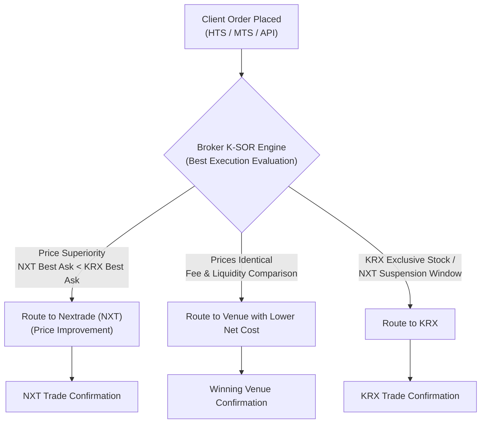
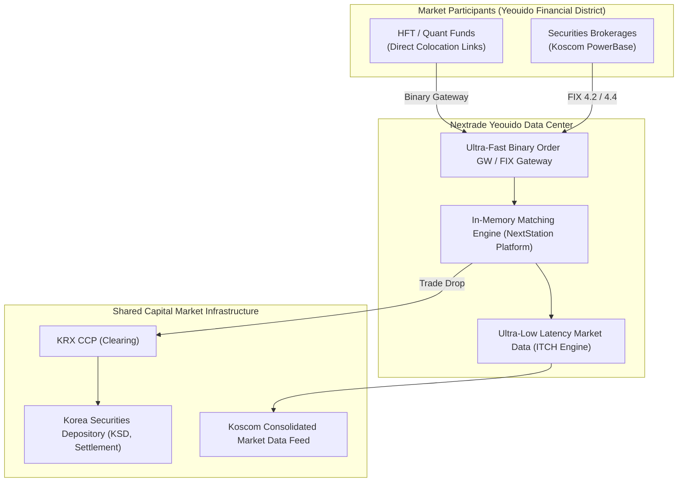

# Nextrade (NXT)

> **Last Updated:** 2026-10-22  
> **Research Grade:** Tier 1 (Official regulations, Financial Services Commission authorization standards, Best Execution criteria)  
> **Market Classification:** Alternative Trading System (ATS / MTF)  
> **Core Domain:** Equities (KOSPI & KOSDAQ Common Stocks), ETFs (Expanding in November 2026)

---

## 1. Overview & Profile

Nextrade (commonly abbreviated as **NXT**) is South Korea's first **Alternative Trading System (ATS / Multilateral Trading Facility)**, officially launched in March 2025. It brought an end to approximately 70 years of single-exchange monopoly held by the Korea Exchange (KRX) since the founding of the Daehan Stock Exchange in 1956, officially inaugurating a competitive **dual-exchange market structure** in the Korean capital market.

| Item | Details |
|------|---------|
| Official Name | Nextrade Co., Ltd. (넥스트레이드 주식회사) |
| Ticker / Abbreviation | NXT |
| Official Website | [https://www.nextrade.co.kr](https://www.nextrade.co.kr) |
| Establishment / Launch | November 2022 (Incorporation) / March 2025 (Commercial Launch) |
| Headquarters Location | Yeouido-dong, Yeongdeungpo-gu, Seoul, Republic of Korea |
| Legal Status | Alternative Trading System (ATS) under Article 8-2 of the Financial Investment Services and Capital Markets Act (FSCMA) |
| Regulatory Authorities | Financial Services Commission (FSC) / Financial Supervisory Service (FSS) |
| Ownership Structure | Joint venture consortium of Korea Financial Investment Association (KOFIA), 26 major securities firms (Mirae Asset, Korea Investment, NH, Samsung, KB, Kiwoom, etc.), and IT/infrastructure leaders (Koscom, Kakao Pay Securities) |
| Eligible Securities | Top ~800 highly liquid KOSPI and KOSDAQ common stocks (ETFs expanding November 2026) |
| Trading Hours | **08:00 – 20:00 KST (12 hours of total continuous/extended trading)** |
| Clearing & Settlement | **Unified T+2 Settlement** (KRX acts as Central Counterparty CCP; Korea Securities Depository KSD handles settlement) |
| IT Infrastructure Partner | Koscom Financial Cloud IT Infrastructure & high-performance matching platform |

### Chronology

- **August 2013:** Revision of the Capital Markets Act legalizing the establishment of Alternative Trading Systems (ATS).
- **2019 – 2021:** ATS Establishment Promotion Committee launched by KOFIA and leading brokerage houses.
- **November 2022:** Nextrade Co., Ltd. officially incorporated.
- **March 2023:** Preliminary ATS regulatory approval granted by the Financial Services Commission (FSC).
- **October 2024:** Core matching platform, K-SOR (Smart Order Routing), and integrated market surveillance engines deployed; industry-wide mock testing initiated.
- **December 2024:** Final regulatory operating license approved by the FSC.
- **March 2025:** **Official launch of NXT** (inaugurating 12-hour trading from 08:00 to 20:00, introducing Midpoint and Stop-Limit orders to Korea).
- **July 2025:** Reached 25–30% market share in daily trading volume for top KOSPI 200 large-cap names.
- **March 2026:** 1st Anniversary system capacity expansion and ultra-low latency binary protocol enhancements.
- **October 2026 (Current):** Sustained multi-trillion KRW daily trading turnover; final preparations underway for November 2026 ETF trading launch.

---

## 2. Market Structure & Trading Sessions

Nextrade operates an extended **12-hour continuous liquidity schedule from 08:00 to 20:00 KST**, significantly expanding beyond KRX's traditional 09:00–15:30 window.



### Detailed Session Timeline

| Session | Hours (KST) | UTC Equivalent | Matching Mechanism | Eligible Order Types | Notes |
| :--- | :--- | :--- | :--- | :--- | :--- |
| **Pre-Market** | **08:00 – 08:50** | 23:00 – 23:50 (D-1) | **Continuous Trading** | Limit, Best Limit, Top of Book, **GTP** | Absorbs overnight global market events |
| *Session Break* | 08:50 – 09:00:30 | 23:50 – 00:00:30 | Suspended | Order entry paused | Prevents conflict with KRX Opening Auction |
| **Main Market** | **09:00:30 – 15:20** | 00:00:30 – 06:20 | **Continuous Trading** | **All Order Types** (Limit, Market, **Midpoint**, **Stop-Limit**, etc.) | Parallel with KRX regular session via SOR |
| *Session Break* | 15:20 – 15:30 | 06:20 – 06:30 | Suspended | Order entry paused | Prevents conflict with KRX Closing Auction |
| **Closing Price Market** | **15:30 – 16:00** | 06:30 – 07:00 | **Fixed Execution at KRX Close** | Closing Price Limit Orders | Matches orders strictly at KRX official closing price |
| **After-Market** | **16:00 – 20:00** | 07:00 – 11:00 | **Continuous Trading** | Limit, Best Limit, Top of Book | Accommodates evening retail & earnings reports |

> **Order Entry Special Rules:**
> - After-market orders can be **entered in advance starting at 15:30**, with continuous executions starting promptly at 16:00.
> - To preserve market integrity and prevent price distortion around KRX's official Opening (09:00) and Closing (15:30) single-price auctions, NXT trading halts during 08:50–09:00:30 and 15:20–15:30.

---

## 3. Tick Sizes & Price Limits

### 3.1 Price Limits
- **Daily Price Band:** **±30% relative to the prior session KRX Base Reference Price** (identical to KRX KOSPI and KOSDAQ rules).
- NXT does not establish independent daily price limits through isolated opening/closing auctions, ensuring cross-market pricing coherence with KRX.

### 3.2 Tick Size Schedule

Nextrade adheres to the standard KRX minimum price variation schedule, while enabling half-tick granularity for Midpoint orders.

| Price Range (KRW) | Standard Limit Tick Size | Midpoint Order Execution Granularity |
| :--- | :--- | :--- |
| **Under 2,000** | **1 KRW** | Executable in 0.5 KRW increments |
| **2,000 to < 5,000** | **5 KRW** | Executable in 2.5 KRW increments |
| **5,000 to < 20,000** | **10 KRW** | Executable in 5.0 KRW increments |
| **20,000 to < 50,000** | **50 KRW** | Executable in 25.0 KRW increments |
| **50,000 to < 200,000** | **100 KRW** | Executable in 50.0 KRW increments |
| **200,000 to < 500,000** | **500 KRW** | Executable in 250.0 KRW increments |
| **500,000 and above** | **1,000 KRW** | Executable in 500.0 KRW increments |

> **Sub-penny Effect of Midpoint Orders:**  
> Standard limit orders must adhere strictly to integer tick increments. However, NXT's newly introduced **Midpoint Order** calculates the arithmetic average of the National Best Bid and Offer (NBBO), allowing **half-tick sub-penny executions** that grant tangible price improvement to both buyers and sellers.

---

## 4. Matching Engine & Innovative Order Types

### 4.1 Matching Principles
1. **Price Priority:** Higher buy orders take precedence over lower buy orders; lower sell orders take precedence over higher sell orders.
2. **Time Priority:** Among orders at the identical price level, earlier entered orders are matched first.
3. **Full Continuous Trading:** Unlike KRX's batch call auctions at open and close, NXT employs real-time **continuous matching across all active trading sessions**, including pre- and after-market hours.



### 4.2 Comprehensive Order Type Specifications

#### 1) Standard Orders
- **Limit Order:** Executable at the designated price or better (permitted across all sessions).
- **Market Order:** Executable immediately at the best available prices (**permitted in Main Market only**; restricted during pre- and after-market to prevent extreme slippage).
- **Best Limit Order:** Prices dynamically to the contra-side best quote at receipt.
- **Top of Book Limit Order:** Prices dynamically to the same-side best quote at receipt.

#### 2) Conditional Time-in-Force Orders
- **IOC (Immediate-or-Cancel):** Fills available quantity immediately; unexecuted remainder is canceled automatically without resting on the book.
- **FOK (Fill-or-Kill):** Requires immediate execution of the entire order quantity; otherwise, the full order is immediately killed.
- **GTP (Good Till Pre-market):** Valid strictly during the Pre-Market session (08:00–08:50); unexecuted balances are automatically wiped before the Main Market opens.

#### 3) ATS Proprietary Order Innovations

```
[ NXT Price Improvement Mechanism ]

   Standard Best Ask: 50,200 KRW
   ---------------------------------
   ★ Midpoint Order: 50,100 KRW  <--- (Resting at exact midpoint, providing 100 KRW price improvement!)
   ---------------------------------
   Standard Best Bid: 50,000 KRW

   ※ Stop-Limit: If market drops to 48,000 KRW (Stop Price), submits Limit Sell at 47,800 KRW.
```

1. **Midpoint Order:**
   - **Definition:** Automatically floats and executes at the exact **mathematical midpoint** between the consolidated best bid and offer across KRX and NXT.
   - **Benefit:** Cuts bid-ask spread friction by 50%, mitigating adverse selection and market impact for institutional block orders and retail investors alike.
2. **Stop-Limit Order:**
   - **Definition:** A conditional order dormant in the system until a pre-designated **Stop Price** is touched, upon which a pre-configured **Limit Order** is submitted directly into the continuous order book.
   - **Use Case:** Crucial risk management mechanism for automated stop-loss protection during sudden price declines, or momentum breakout entries above key resistance levels.

---

### 4.3 Order Book Simulation Scenario

#### Scenario: Price Improvement via Midpoint Order Matching

- **Initial Market State (Samsung Electronics Order Book):**
  - KRX Best Bid: `70,000 KRW` (1,000 shares)
  - KRX Best Ask: `70,200 KRW` (1,500 shares)
  - Prevailing Spread: `200 KRW`

```
[Pre-execution Consolidated Book]
Best Ask: 70,200 KRW (1,500 shares)
---------------------------------------
Consolidated Midpoint: 70,100 KRW
---------------------------------------
Best Bid: 70,000 KRW (1,000 shares)
```

1. **[Step 1] Institutional Trader A enters Midpoint Sell Order:**
   - Trader A submits `Sell 500 shares Midpoint` to NXT.
   - NXT engine queues 500 shares at **70,100 KRW** in the hidden midpoint order queue.
2. **[Step 2] Retail Trader B enters Midpoint Buy Order:**
   - Trader B submits `Buy 300 shares Midpoint` via broker MTS.
3. **[Step 3] Matching Engine Execution:**
   - NXT engine matches 300 shares at exactly 70,100 KRW.
   - **Result:**
     - Buyer B purchases at `70,100 KRW`—**saving 100 KRW per share** compared to the displayed ask (`70,200 KRW`).
     - Seller A sells at `70,100 KRW`—**receiving 100 KRW more per share** compared to the displayed bid (`70,000 KRW`).
     - Both parties successfully capture 50% spread savings.

---

## 5. Best Execution Policy & K-SOR

Under Article 68 of the FSCMA, Korean securities firms operating under a multi-venue environment are legally obligated to provide **Best Execution** for investor orders. The algorithmic infrastructure enabling this is the **Smart Order Router (SOR)**.



### Key SOR Routing Criteria

1. **Price Priority:** Buy orders route to the exchange with the lowest ask; sell orders route to the exchange with the highest bid.
2. **Cost Priority:** When displayed quotes are identical, the engine selects the venue with **lower exchange trading fees (NXT fees are 20–40% lower than KRX)**.
3. **Liquidity Depth & Fill Probability:** For larger order sizes, SOR intelligently splits orders across both books to minimize aggregate market impact.
4. **Speed & Latency:** In high-volatility situations, execution probability and line latency determine routing priority.

---

## 6. Volatility Controls & Risk Management

To safeguard market stability, NXT implements a synchronized circuit breaker and volatility interruption framework harmonized with KRX.

| Mechanism | Trigger Criteria | NXT Action |
| :--- | :--- | :--- |
| **Static Volatility Interruption (Static VI)** | Potential match price deviates ±10% from the previous single-price base | **2-minute trading suspension** (NXT halts trading during KRX's 2-minute call auction to prevent off-market price divergence) |
| **Dynamic Volatility Interruption (Dynamic VI)** | Sudden price change of 2–6% against the immediately preceding execution | 2-minute pause coordinated with market |
| **Market-wide Circuit Breaker (CB)** | KOSPI / KOSDAQ index declines by 8%, 15%, or 20% | **Immediate 20-minute trading halt across all NXT securities** (100% synchronized with KRX) |
| **Sidecar** | Sudden fluctuations in stock index futures prices | Automated algorithmic program trading quotes suspended for 5 minutes |
| **ATS Volume Cap Regulation** | Statutory regulatory ceiling under FSCMA Enforcement Decree | **15% aggregate market volume cap**, **30% individual stock volume cap**; new buy order inflows automatically throttled upon reaching thresholds |

---

## 7. Fee Structure & Economics

Nextrade charges transaction fees that are **20% to 40% lower than the Korea Exchange (KRX)**, creating substantial cost savings for institutional and retail participants.

### Exchange Transaction Fee Comparison

| Category | Korea Exchange (KRX) Baseline | Nextrade (NXT) Baseline | Cost Reduction |
| :--- | :--- | :--- | :--- |
| **Limit Order (Maker)** | ~0.0023% – 0.0027% | **~0.0013%** | **~40% – 50% Reduction** |
| **Market Order (Taker)** | ~0.0023% – 0.0027% | **~0.0018%** | **~25% – 30% Reduction** |
| **Securities Transaction Tax** | 0.15% (including Agricultural Special Tax) | **0.15% (Identical)** | Standardized tax policy |

> **Maker-Taker Incentive Model:**  
> By assessing a reduced fee of 0.0013% on passive liquidity-providing orders (Makers) versus 0.0018% on active aggressive orders (Takers), NXT incentivizes tight spreads and deep order book liquidity. This competitive pressure prompted KRX to introduce its own tiered maker-taker fee structures in late 2025.

---

## 8. IT Infrastructure, Protocol & Connectivity



| Infrastructure Component | Specification |
| :--- | :--- |
| **Matching Engine Platform** | **NextStation Platform (In-memory ultra-low-latency matching engine)** |
| **System Developer** | Developed in partnership with **Koscom** based on leading global ATS/MTF benchmarks |
| **Core Latency** | **Tens of microseconds (µs) Round-Trip Time (RTT)** |
| **Order Gateway Protocols** | Standard **FIX 4.2 / 4.4** Gateway & proprietary **High-Speed Binary Protocol** |
| **Market Data Feed** | UDP Multicast ITCH-style full-depth order book feed |
| **Primary Data Center** | Koscom Financial Cloud IDC, **Yeouido, Seoul** |
| **Co-location Services** | 10G/40G low-latency rack cross-connects for HFTs and Liquidity Providers (LPs) |

---

## 9. Clearing & Settlement Infrastructure

Cross-venue clearing integrity and systemic risk prevention are ensured by centralized national clearing institutions:

- **Central Counterparty (CCP):** **Korea Exchange (KRX Clearing Division)**  
  - All executions on NXT are streamed directly to KRX CCP in real time and multilaterally netted against KRX trades.
  - Counterparty risk is 100% eliminated through KRX CCP settlement guarantees.
- **Central Securities Depository (CSD):** **Korea Securities Depository (KSD)**  
  - Book-entry transfer of securities and cash settlement occurs through KSD registered accounts.
- **Settlement Cycle:** **T+2 Unified Settlement**  
  - Seamlessly unified with KRX settlement timelines, enabling fungible clearing of shares bought on NXT and sold on KRX (or vice versa).

---

## 10. 2026 Latest Updates & Market Impact

1. **Market Share Consolidation:**
   - After expanding from ~10% upon inception in 2025, NXT has secured an established 25–30% volume share across major KOSPI 200 liquid constituents as of late 2026.
   - The Pre-Market (08:00–08:50) and After-Market (16:00–20:00) sessions account for nearly 20% of NXT's total daily trading volume, fostering a vibrant after-hours trading culture in Korea.
2. **November 2026 ETF Trading Expansion:**
   - Extending from the initial universe of 800 common stocks to domestically listed ETFs (KODEX, TIGER, RISE, ACE, etc.).
   - Investors trading U.S.-pegged index ETFs (S&P 500, Nasdaq 100) benefit extensively from pre-market hours tracking overnight U.S. cash sessions.
3. **Catalyst for Capital Market Modernization:**
   - NXT's successful entry has driven structural advancements across Korea's financial ecosystem: lower transaction costs, algorithmic adoption, extended trading access, and enhanced execution quality for all market participants.
