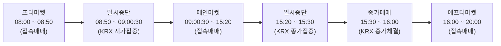
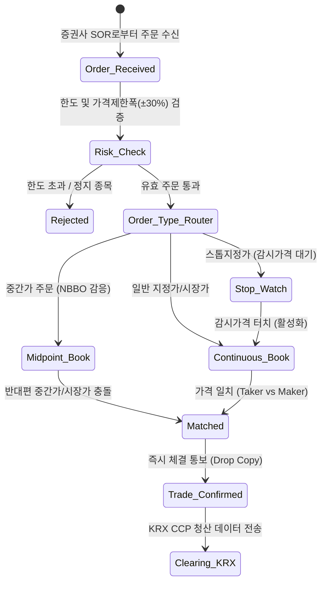
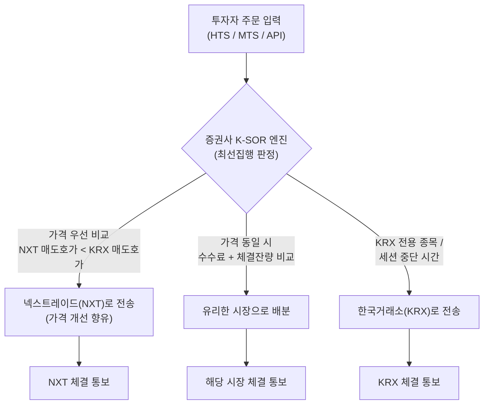
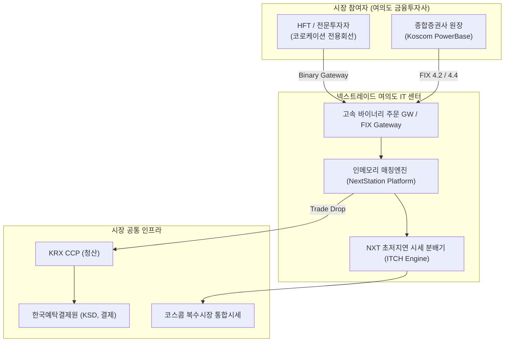

# Nextrade (NXT, 넥스트레이드)

> **최종 업데이트:** 2026-10-22  
> **조사 등급:** Tier 1 (공식 규정, 금융위원회 인가 기준, 최선집행기준 세부 준용)  
> **시장 분류:** 다자간매매체결회사 (대체거래소, ATS / MTF)  
> **주요 도메인:** 주식 (KOSPI & KOSDAQ 보통주), ETF (2026년 11월 확대)

---

## 1. 개요 및 프로필 (Overview & Profile)

넥스트레이드(Nextrade, 약칭 **NXT**)는 2025년 3월 공식 출범한 대한민국 최초의 **다자간매매체결회사(ATS, Alternative Trading System)**입니다. 1956년 대한증권거래소 설립 이후 약 70년간 이어진 한국거래소(KRX)의 단일 독점 체제를 종식시키고, 대한민국 자본시장에 본격적인 **복수거래소 경쟁 체제**를 도입한 역사적인 거래 플랫폼입니다.

| 항목 | 내용 |
|------|------|
| 공식 명칭 | 넥스트레이드 주식회사 (Nextrade Co., Ltd.) |
| 영문 약칭 | NXT |
| 웹사이트 | [https://www.nextrade.co.kr](https://www.nextrade.co.kr) |
| 설립 일자 | 2022년 11월 (법인 설립) / 2025년 3월 (공식 상업 가동) |
| 본사 소재지 | 대한민국 서울특별시 영등포구 여의도동 |
| 법적 지위 | 자본시장과 금융투자업에 관한 법률 제8조의2에 따른 **다자간매매체결회사(ATS)** |
| 감독 기관 | 금융위원회 (FSC) / 금융감독원 (FSS) |
| 소유 구조 | 금융투자협회(KOFIA) 및 미래에셋증권, 한국투자증권, NH투자증권, 삼성증권, KB증권, 키움증권 등 26개 증권사 및 코스콤(Koscom), 카카오페이증권 등 IT·유관기관 합작 |
| 거래 대상 증권 | KOSPI 및 KOSDAQ 상장 주식 중 유동성 우량 800여 종목 (2026년 11월 ETF 확대) |
| 일평균 매매 시간 | **08:00 ~ 20:00 KST (일일 총 12시간 매매)** |
| 결제 주기 및 청산 | **T+2 일원화** (한국거래소 KRX가 CCP로서 청산, 한국예탁결제원 KSD가 결제 수행) |
| IT 인프라 파트너 | 코스콤 (Koscom) 금융 IT 클라우드 인프라 기반 고성능 엔진 |

### 주요 연혁 (Chronology)

- **2013년 8월:** 자본시장법 개정으로 다자간매매체결회사(ATS) 설립 근거 법제화.
- **2019년 ~ 2021년:** 금융투자협회 및 주요 대형 증권사 주도로 ATS 설립 추진위원회 발족.
- **2022년 11월:** 넥스트레이드 주식회사 법인 설립 등기.
- **2023년 3월:** 금융위원회로부터 다자간매매체결회사 예비인가 취득.
- **2024년 10월:** 거래소 코어 매칭 시스템, K-SOR, 통합 시장감시 시스템 구축 완료 및 증권사 연계 모의테스트 개시.
- **2024년 12월:** 금융위원회로부터 본인가 의결.
- **2025년 3월:** 대한민국 자본시장 사상 최초로 **NXT 정식 가동 개시** (08:00~20:00 12시간 거래, 중간가 및 스톱지정가 호가 도입).
- **2025년 7월:** KOSPI 200 주요 대형주 거래대금 기준 시장점유율 25~30% 돌파.
- **2026년 3월:** 출범 1주년 기념 시스템 증설 및 저지연 바이너리 프로토콜 고도화.
- **2026년 10월 현재:** 일평균 거래대금 수조 원 달성 및 2026년 11월 ETF 매매 세션 도입 준비 완료.

---

## 2. 시장 구조 및 매매 세션 (Market Structure & Trading Sessions)

넥스트레이드는 기존 한국거래소(KRX)의 정규 거래시간(09:00 ~ 15:30)을 대폭 뛰어넘는 **오전 8시부터 밤 8시까지 일일 총 12시간**의 연속적인 유동성 공급 세션을 운영합니다.



### 세부 매매 세션 타임라인

| 세션 구분 | 운영 시간 (KST) | UTC 환산 | 매매 체결 방식 | 허용 주문 유형 | 비고 |
| :--- | :--- | :--- | :--- | :--- | :--- |
| **프리마켓 (Pre-Market)** | **08:00 ~ 08:50** | 23:00 ~ 23:50 (D-1) | **접속매매** (연속 체결) | 지정가, 최유리지정가, 최우선지정가, **GTP** | 장 개시 전 글로벌 시장 변동 반영 |
| *세션 정비 및 휴장* | 08:50 ~ 09:00:30 | 23:50 ~ 00:00:30 | 매매 중단 | 호가 접수 일시 정지 | KRX 시가 결정 단일가매매 집중 지원 |
| **메인마켓 (Main-Market)** | **09:00:30 ~ 15:20** | 00:00:30 ~ 06:20 | **접속매매** (연속 체결) | **전체 주문 허용** (지정가, 시장가, **중간가**, **스톱지정가** 등) | KRX 정규장과 병행, SOR 실시간 최선집행 |
| *세션 정비 및 휴장* | 15:20 ~ 15:30 | 06:20 ~ 06:30 | 매매 중단 | 호가 접수 일시 정지 | KRX 종가 결정 단일가매매 집중 지원 |
| **종가매매시장** | **15:30 ~ 16:00** | 06:30 ~ 07:00 | **당일 확정 종가 체결** | 당일 종가 지정가 주문 | KRX가 확정한 최종 종가로 즉시 일괄 체결 |
| **애프터마켓 (After-Market)** | **16:00 ~ 20:00** | 07:00 ~ 11:00 | **접속매매** (연속 체결) | 지정가, 최유리지정가, 최우선지정가 | 퇴근길 직장인 및 저녁 뉴스·실적 발표 거래 지원 |

> **호가 접수 시간 특례:**
> - 애프터마켓 호가는 **15:30부터 사전 접수**가 가능하며, 체결은 16:00부터 정식 개시됩니다.
> - KRX의 시가(09:00) 및 종가(15:30) 단일가 호가 수집 기간과의 가격 왜곡 및 시세 간섭을 방지하기 위하여, 해당 전후 구간(08:50~09:00:30, 15:20~15:30) 동안은 NXT의 매매가 완전히 정지됩니다.

---

## 3. 호가 단위 및 가격 변동폭 (Tick Sizes & Price Limits)

### 3.1 가격 변동 제한폭 (Price Limits)
- **일일 가격 제한폭:** **전일 KRX 기준가격 대비 ±30%** (KRX 유가증권시장 및 코스닥시장 업무규정과 동일).
- NXT는 독립적인 시가/종가 경매를 통해 가격 변동폭을 새로 확장하지 않으며, 모(母)시장인 KRX가 확정한 당일 기준가격을 공유하여 시장 혼란을 원천 차단합니다.

### 3.2 호가 단위 (Tick Size Schedule)

기본적으로 유가증권시장 및 코스닥시장의 표준 틱 사이즈를 준용합니다.

| 주가 범위 (KRW) | 일반 주문 틱 사이즈 (Tick Size) | 중간가 호가 (Midpoint) 체결 단위 |
| :--- | :--- | :--- |
| **2,000원 미만** | **1원** | 0.5원 단위 체결 가능 |
| **2,000원 이상 ~ 5,000원 미만** | **5원** | 2.5원 단위 체결 가능 |
| **5,000원 이상 ~ 20,000원 미만** | **10원** | 5.0원 단위 체결 가능 |
| **20,000원 이상 ~ 50,000원 미만** | **50원** | 25.0원 단위 체결 가능 |
| **50,000원 이상 ~ 200,000원 미만** | **100원** | 50.0원 단위 체결 가능 |
| **200,000원 이상 ~ 500,000원 미만** | **500원** | 250.0원 단위 체결 가능 |
| **500,000원 이상** | **1,000원** | 500.0원 단위 체결 가능 |

> **중간가 호가의 서브틱(Sub-penny) 효과:**  
> 일반 지정가 주문은 위 표의 정수 호가단위에만 제출될 수 있으나, NXT가 신설한 **중간가 호가(Midpoint Order)**는 매수 1호가와 매도 1호가의 산술평균 가격으로 체결되므로, 호가단위의 1/2 수준인 **서브틱 체결**을 지원하여 투자자에게 유의미한 가격 개선(Price Improvement)을 제공합니다.

---

## 4. 매매체결 방식 및 혁신 주문 유형 (Order Types & Matching Engine)

### 4.1 매매체결 원칙
1. **가격 우선의 원칙 (Price Priority):** 고가 매수 주문은 저가 매수 주문보다 우선하며, 저가 매도 주문은 고가 매도 주문보다 우선합니다.
2. **시간 우선의 원칙 (Time Priority):** 동일 가격 주문의 경우 먼저 접수된 주문이 우선 체결됩니다.
3. **접속매매 전면 적용:** 프리마켓과 애프터마켓을 포함한 정규 거래 시간 내내 단일가 경매가 아닌 **실시간 연속 접속매매(Continuous Trading)**로 체결됩니다.



### 4.2 주요 주문 유형 세부 명세

#### 1) 일반 주문
- **지정가 주문 (Limit Order):** 지정한 가격 또는 그보다 유리한 가격으로 체결을 요구하는 주문 (전 세션 허용).
- **시장가 주문 (Market Order):** 가격을 지정하지 않고 즉시 체결 가능한 가장 유리한 가격으로 체결을 요구하는 주문 (**메인마켓에서만 허용**, 급격한 시세 변동 방지를 위해 프리/애프터마켓에서는 제한).
- **최유리지정가 주문 (Best Limit Order):** 주문 접수 시점의 상대방 최우선 호가 가격으로 지정되는 주문.
- **최우선지정가 주문 (Top of Book Limit Order):** 주문 접수 시점의 자기 편 최우선 호가 가격으로 지정되는 주문.

#### 2) 조건부 주문 (Time-in-Force)
- **IOC (Immediate-or-Cancel):** 접수 즉시 체결 가능한 수량은 체결시키고, 미체결 잔량은 호가창에 남기지 않고 즉시 취소.
- **FOK (Fill-or-Kill):** 주문 즉시 전량이 일괄 체결되지 않으면 전량을 취소.
- **GTP (Good Till Pre-market):** 프리마켓(08:00~08:50)에만 효력이 유지되며, 메인마켓 진입 전 미체결 수량이 전량 자동 취소되는 세션 특화 주문.

#### 3) 대체거래소(NXT) 특화 혁신 주문

```
[ NXT 신규 호가 비교도 ]

   일반 매도호가: 50,200원
   ------------------------
   ★ 중간가 호가: 50,100원  <--- (매도·매수 스프레드의 정중앙에서 대기 및 체결, 100원 가격 개선!)
   ------------------------
   일반 매수호가: 50,000원

   ※ 스톱지정가: 주가가 48,000원(감시가격) 이하로 하락 시, 47,800원 지정가 매도 주문 자동 발주
```

1. **중간가 호가 (Midpoint Order):**
   - **정의:** 한국거래소(KRX)와 넥스트레이드(NXT)의 통합 최우선 매수호가(Best Bid)와 최우선 매도호가(Best Ask)의 **산술적 중간값(Midpoint)**으로 체결 가격이 실시간 자동 추종되는 호가입니다.
   - **장점:** 스프레드 비용을 50% 절감할 수 있으며, 기관 투자자 및 알고리즘 트레이더의 대량 분할 주문 시 시장 충격(Market Impact)을 최소화합니다.
2. **스톱지정가 호가 (Stop-Limit Order):**
   - **정의:** 투자자가 사전에 설정한 **감시가격(Stop Price)**에 시장 가격이 도달하면, 미리 설정해 둔 **지정가(Limit Price)**로 호가가 호가창에 자동으로 제출되는 조건부 예약 주문입니다.
   - **활용:** 예상치 못한 주가 급락 시 자동 손절매(Stop-Loss) 주문을 걸어두거나, 특정 저항선을 돌파할 때 추세 추종 매수(Breakout Buying) 진입 시 유용합니다.

---

### 4.3 실전 오더북 체결 시뮬레이션 시나리오

#### 시나리오: 중간가 호가(Midpoint) 체결을 통한 가격 개선

- **기초 시장 상황 (삼성전자 오더북):**
  - KRX 최우선 매수호가: `70,000원` (1,000주)
  - KRX 최우선 매도호가: `70,200원` (1,500주)
  - 스프레드: `200원`

```
[체결 전 오더북]
매도 잔량: 70,200원 (1,500주)
---------------------------------------
중간가격 (Midpoint): 70,100원
---------------------------------------
매수 잔량: 70,000원 (1,000주)
```

1. **[Step 1] 기관 투자자 A의 중간가 매도 주문 진입:**
   - 투자자 A가 NXT에 `중간가 매도 500주`를 제출.
   - NXT 엔진은 현재 통합 최우선 호가의 중간값인 **70,100원**에 비표시/중간가 큐를 생성하여 대기시킴.
2. **[Step 2] 개인 투자자 B의 중간가 매수 주문 진입:**
   - 투자자 B가 증권사 MTS를 통해 `중간가 매수 300주`를 제출.
3. **[Step 3] 매칭 엔진 체결 실행:**
   - NXT 매칭 엔진은 70,100원에서 300주 즉시 매칭 체결.
   - **결과:** 
     - 매수자 B는 일반 매도호가(70,200원) 대비 **주당 100원 저렴하게 매수** (가격 개선).
     - 매도자 A는 일반 매수호가(70,000원) 대비 **주당 100원 비싸게 매도** (가격 개선).
     - 양 당사자 모두 50% 스프레드 비용 절감 효과 향유.

---

## 5. 최선집행의무(Best Execution Policy) 및 K-SOR

대한민국 자본시장법 제68조에 따라, 복수거래소 체제 하에서 증권사는 고객의 주문을 가장 유리한 조건으로 집행해야 하는 **최선집행의무(Best Execution)**를 부담합니다. 이를 전산적으로 자동화한 시스템이 **스마트 주문 라우팅(SOR, Smart Order Routing)**입니다.



### SOR 분기 핵심 평가 기준

1. **가격 우선 (Price):** 투자자가 매수할 때는 더 낮은 매도호가가 있는 시장으로, 매도할 때는 더 높은 매수호가가 있는 시장으로 자동 발주.
2. **비용 우선 (Cost):** 양 시장의 호가 가격이 동일한 경우, **거래 수수료(NXT가 KRX보다 저렴)**를 감안하여 총 비용이 적게 드는 시장을 선택.
3. **수량 및 체결 가능성 (Liquidity & Likelihood):** 대량 주문의 경우 분할 체결 시 시장 충격을 감안하여 잔량이 풍부한 곳으로 호가를 지능형 분할(Split) 전송.
4. **시간 우선 (Speed):** 시세 변동성이 극심할 경우 주문 지연시간이 짧은 경로로 라우팅.

---

## 6. 변동성 완화장치 및 시장 리스크 관리 (Volatility Controls)

NXT는 시장의 건전성과 가격 안정성을 유지하기 위하여 한국거래소(KRX)의 시장조치와 긴밀하게 연동되는 안전장치를 갖추고 있습니다.

| 제도 | 세부 연동 메커니즘 | NXT 조치 사항 |
| :--- | :--- | :--- |
| **정적 변동성 완화장치 (정적 VI)** | 잠정 체결가격이 직전 단일가 대비 ±10% (정규장) 초과 시 | **해당 종목 매매 2분간 일시 중단** (KRX가 2분간 단일가 경매를 진행하는 동안 NXT도 거래를 일시 정지하여 시세 왜곡 방지) |
| **동적 변동성 완화장치 (동적 VI)** | 잠정 체결가격이 직전 체결가 대비 일정 비율(2~6%) 급변 시 | 2분간 매매 중단 및 단일가 전환 연동 |
| **서킷브레이커 (CB)** | KOSPI / KOSDAQ 지수가 전일 대비 8%, 15%, 20% 폭락 시 | **NXT 전 종목 매매 20분간 즉시 일괄 거래 정지** (KRX와 100% 동기화) |
| **사이드카 (Sidecar)** | 선물 가격 급변 시 프로그램 매매 호가 효력 일시 정지 | NXT 내 프로그램 매매 호가 효력 5분간 정지 |
| **ATS 거래량 상한 규제** | 자본시장법 시행령에 따른 시장 점유율 캡 | **시장 전체 거래대금의 15%**, **개별 종목 거래대금의 30%** 초과 시 신규 매수 주문 접수 자동 차단 |

---

## 7. 수수료 및 거래 비용 구조 (Fee Structure & Economics)

넥스트레이드는 KRX 독점 체제 하의 수수료보다 **20% ~ 40% 저렴한 수수료**를 책정하여 시장 점유율을 적극적으로 확보하고 있습니다.

### 거래소 수수료율 비교 (기본 기준)

| 구분 | 한국거래소 (KRX) 기준 | 넥스트레이드 (NXT) 기준 | 수수료 절감률 |
| :--- | :--- | :--- | :--- |
| **지정가 주문 (Maker)** | 약 0.0023% ~ 0.0027% | **약 0.0013%** | **약 40% ~ 50% 인하** |
| **시장가 주문 (Taker)** | 약 0.0023% ~ 0.0027% | **약 0.0018%** | **약 25% ~ 30% 인하** |
| **증권거래세** | 0.15% (농특세 포함) | **0.15% (동일 적용)** | 세법상 동일 과세 |

> **메이커-테이커(Maker-Taker) 인센티브:**  
> 호가창에 유동성을 공급하는 지정가 주문(Maker)에 더 낮은 수수료율(0.0013%)을 부과하고, 유동성을 소비하는 시장가 주문(Taker)에는 0.0018%를 부과하여 투자자들의 적극적인 매수/매도 호가 제출을 유도합니다. 이에 자극받아 KRX 역시 2025년 말 메이커-테이커 차등 수수료 제도를 도입하는 등 시장 전반의 거래 비용 절감 효과가 유발되었습니다.

---

## 8. IT 인프라, 통신 프로토콜 및 데이터센터 (IT & Network)



| 인프라 항목 | 상세 규격 및 명세 |
| :--- | :--- |
| **매칭 엔진 명칭** | **NextStation Platform (인메모리 초저지연 매칭 엔진)** |
| **시스템 구축사** | **코스콤 (Koscom)** 금융 IT 전문 엔지니어링 및 해외 유수 ATS 아키텍처 벤치마킹 |
| **코어 레이턴시** | **왕복 지연시간(RTT) 수십 마이크로초(µs)** 단위 초고속 병렬 처리 |
| **주문 인터페이스** | **FIX 4.2, FIX 4.4** 표준 프로토콜 및 **독자 고속 바이너리 게이트웨이(Binary Protocol)** 지원 |
| **시세 인터페이스** | UDP 멀티캐스트 기반 ITCH 스타일 초저지연 오더북 풀 뎁스(Full-Depth) 피드 |
| **데이터센터 (IDC)** | 서울 영등포구 **여의도 코스콤 금융클라우드 IDC** 센터 위치 |
| **코로케이션 (Co-location)** | 초단타(HFT) 및 마켓메이커(LP)를 위한 여의도 IDC 내 10G/40G 저지연 근접 랙 제공 |

---

## 9. 청산 및 결제 인프라 (Clearing & Settlement)

복수거래소가 출범하더라도 투자자의 결제 안정성을 완벽하게 보장하기 위해, 청산 및 결제 인프라는 국가 공인 중앙 기관으로 일원화되어 운영됩니다.

- **중앙청산소 (CCP):** **한국거래소 (KRX 청산결제본부)**  
  - NXT에서 체결된 모든 매매 내역은 실시간으로 KRX 청산 시스템으로 전송되어, KRX 매매분과 통합 네팅(Multilateral Netting) 처리됩니다.
  - 거래 상대방 위험(Counterparty Risk)은 KRX CCP의 결제이행보증을 통해 100% 해소됩니다.
- **중앙예탁기관 (CSD):** **한국예탁결제원 (KSD)**  
  - 주식 및 매매대금의 최종 이동과 권리 배정은 한국예탁결제원의 증권등기계좌부를 통해 이루어집니다.
- **결제 주기:** **T+2일 결제**  
  - KRX와 완전히 동일한 주기로 결제되므로 투자자는 NXT에서 매수한 주식을 매매일 포함 3영업일째에 KRX 매도분과 함께 차감 결제할 수 있습니다.

---

## 10. 2026년 하반기 최신 동향 및 시장 영향 분석 (2026 Updates)

1. **거래 점유율의 구조적 안착:**
   - 2025년 출범 초기 10%대였던 대형주 거래 점유율이 2026년 하반기 현재 25~30% 수준으로 안착했습니다.
   - 특히 출근 시간대(08:00~08:50) 프리마켓과 퇴근 시간대(16:00~20:00) 애프터마켓의 거래 비중이 전체의 약 20%를 차지하며 새로운 야간 주식 투자 문화를 형성했습니다.
2. **2026년 11월 ETF 거래 확장 개시:**
   - 기존 개별 주식 800여 종목에 한정되었던 거래 대상이 국내 상장 ETF(KODEX, TIGER, RISE, ACE 등) 전반으로 확장됩니다.
   - 글로벌 지수 추종 ETF(S&P 500, 나스닥 100 등)의 경우 미국 시장 개장 전 프리마켓 시간대부터 실시간 가격 변동을 반영할 수 있게 되어 투자자 편익이 대폭 증가했습니다.
3. **KRX 독점 종식과 시장 혁신의 가속화:**
   - NXT의 등장으로 KRX 또한 20년 만의 수수료 인하, 메이커-테이커 제도 도입, 야간 파생상품 거래 연장 등 서비스 혁신을 단행함으로써 대한민국 자본시장 전반의 거래 비용 인하와 국제 경쟁력 강화라는 긍정적 시너지를 창출하고 있습니다.
